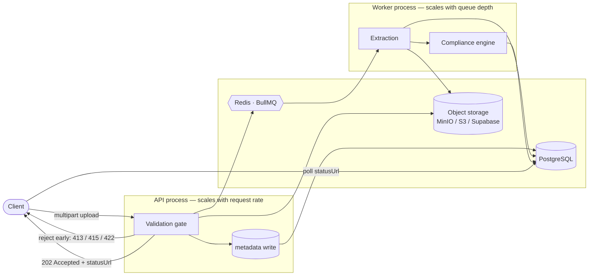

# Vantedge Bid — Tender Document Ingestion & Compliance Audit

A backend service for the two modules in the brief: **Tender Documents** and
**Compliance Audit**. Contractors upload the document package for a tender; the
service validates each file at the edge, processes it asynchronously, extracts
the fields that matter, and audits the package against a versioned ruleset
before the bid is submitted.

NestJS · TypeScript · PostgreSQL · Redis/BullMQ · S3-compatible storage · Docker Compose

---

## Why these two modules belong together

Bids are routinely disqualified for clerical reasons. An SBU that expired two
days before the opening date. A certificate whose subclassification does not
match the announcement. A bid bond below the required percentage. A sister
company's NPWP on one page of the package.

None of these are hard to check. They are tedious, they are checked by hand
under deadline pressure, and the cost of missing one is the whole bid. So
ingestion is not a file-upload feature that happens to store PDFs — it is the
step that turns a pile of documents into facts the compliance engine can reason
about. The data model and the pipeline are both shaped by that.

---

## What runs, and what is only designed

Everything below the first line of this table is working code with tests behind
it. Everything below the second is reasoning about production, written down so
the design can be judged — not implemented, and not claimed to be.

| | Status |
|---|---|
| PostgreSQL schema, ERD, migrations | **Implemented** — 14 tables, applied by `npm run migrate` |
| Document ingestion REST API with size and format validation | **Implemented** — 8-stage gate, [below](#validation-gate) |
| Queue and worker, asynchronous processing | **Implemented** — BullMQ, separate process |
| Content de-duplication and request idempotency | **Implemented** — enforced by the database |
| Rule-based compliance engine over a versioned ruleset | **Implemented** — 10 evaluators, 12 seeded rules |
| Document field extraction | **Implemented, heuristic** — text-layer PDFs only, no OCR |
| OpenAPI documentation | **Implemented** — generated from the code at `/docs` |
| Tests | **Implemented** — 62 unit, 27 integration against a real database |
| — | — |
| AI-assisted document understanding | **Design only** — [Production vision](#production-vision--ai-assisted-compliance-auditing) |
| OCR for scanned documents | **Design only** |
| Human-in-the-loop review workflow | **Design only** |
| Authentication | **Out of scope** — [deliberately](#deliberate-scope-boundaries), with the seam left in place |

The brief asked for an ERD, an ingestion endpoint with basic validation, and a
written scaling strategy. This goes further than that in one specific direction:
the compliance engine actually runs, because a schema for compliance auditing
that has never evaluated a rule is a guess. Everything else is deliberately
bounded, and the boundaries are stated rather than left to be discovered.

---

## Quick start

```bash
cp .env.example .env
docker compose up -d --build        # postgres, redis, minio, migrations, api, worker

npm ci
npm run seed                        # one organisation, one tender
npm run samples                     # nine sample documents, valid and invalid

open http://localhost:3000/docs     # OpenAPI
```

`npm run seed` prints ready-to-paste curl commands with real ids.

Running it without Docker needs Postgres and Redis on their default ports, then:

```bash
npm run migrate
npm run start:dev          # terminal 1 — API
npm run start:worker:dev   # terminal 2 — worker
```

---

## Architecture



Two processes, one codebase. The API admits work; the worker performs it. They
share entities, storage and the database, and they scale on different signals —
the API on request rate, the worker on queue depth. `WorkerModule` is the API's
module graph minus every controller, plus the queue processor.

### The request path

1. **Validate before anything expensive.** Checks run cheapest-first and stop at
   the first failure, so a 60 MB file is rejected on its size before anything
   hashes it.
2. **Write metadata, then bytes.** The version row is committed in `pending`
   *before* the upload. Storage is not transactional, so one of the two has to
   go first — and a crash mid-upload then leaves a visible, sweepable `pending`
   row rather than an orphaned object that nothing references and nobody ever
   finds. Prefer the failure you can see.
3. **Answer 202, not 200.** The response means *durably accepted*, not
   *finished*. It carries a `statusUrl` and a `jobId`.
4. **Process asynchronously.** Extraction and the compliance audit happen in the
   worker, at whatever rate the worker pool can sustain.

### Validation gate

Eight checks, in this order, each with its own error code so a client can act on
the result:

| # | Check | Rejects with |
|---|---|---|
| 1 | File present | `400 file_missing` |
| 2 | Non-empty | `400 file_empty` |
| 3 | Size, against the stricter of the global cap and the document type's own limit | `413 file_too_large` |
| 4 | Declared MIME type on this document type's allow-list | `415 unsupported_media_type` |
| 5 | **Magic bytes agree with the declared type** | `415 file_signature_mismatch` |
| 6 | Filename extension sanity | logged, not rejected |
| 7 | PDF not password protected | `415 file_encrypted` |
| 8 | SHA-256 content address computed | — |

Check 5 is the one that matters. Steps 4 and 6 both read client-supplied
metadata; a shell script renamed to `.pdf` and uploaded with
`Content-Type: application/pdf` passes both. The only trustworthy statement
about a file's type is in its own first bytes.

Check 7 looks ahead. An encrypted PDF uploads and stores perfectly, then yields
no text in the worker — turning a clear 415 at upload time into a mysterious
"processing failed" ten minutes later.

### Compliance engine

Rules live in the database; evaluators live in code. A rule row names an
evaluator (`not_expired_at_deadline`, `classification_match`,
`monetary_threshold`) and supplies its parameters as JSONB. Changing "KSWP must
be younger than 30 days" to 14 is an `UPDATE`, not a deployment.

The evaluator set is deliberately **closed** rather than an expression language.
A compliance product's job is to produce verdicts someone can defend; a DSL
produces verdicts nobody fully understands and inputs nobody has reviewed.

Evaluators are pure functions of a pre-loaded snapshot — no database, no clock,
no I/O. That keeps them unit-testable without a container and keeps the query
count independent of the rule count: twelve rules over thirty documents is four
queries, not three hundred and sixty.

Findings are not binary. `inconclusive` exists because a compliance tool that
silently passes an unreadable certificate is worse than no tool at all.

---

## Data model

Fourteen tables. Full ERD, relationship explanations and the reasoning behind
each decision: **[docs/ERD.md](docs/ERD.md)**.

The four load-bearing ideas:

- **`tender_documents` (slot) is separate from `document_versions` (file).** A
  correction is a new version, never an overwrite, so nothing a past audit cited
  can change underneath it.
- **`checksum_sha256` is unique per organisation.** De-duplication and
  idempotency are enforced by the database, not by convention — which is what
  makes the ingestion endpoint safely retryable.
- **Rulesets are versioned and findings snapshot their severity.** Regulation
  changes. Without this, a verdict rendered in March quietly means something
  different in September, and the product cannot defend its own history.
- **`audit_trail` is append-only.** Mutable rows answer "what is true now"; the
  trail answers "who changed what, when". A compliance product needs both.

---

## API

All endpoints are tenant-scoped through `X-Organization-Id`. Errors are
[RFC 7807](https://www.rfc-editor.org/rfc/rfc7807) problem details with an
additional machine-readable `code`.

| Method | Path | Purpose |
|---|---|---|
| `POST` | `/v1/tenders` | Register a tender |
| `GET` | `/v1/tenders/:id` | Tender with its document slots |
| `POST` | **`/v1/tenders/:id/documents`** | **Ingest a document** |
| `GET` | `/v1/documents/versions/:id/status` | Processing status + extraction |
| `POST` | `/v1/tenders/:id/compliance-audits` | Run an audit |
| `GET` | `/v1/compliance-audits/:id` | Full report, worst findings first |
| `GET` | `/v1/document-types` | Reference data and upload limits |
| `GET` | `/healthz` · `/readyz` · `/metrics/queue` | Probes and queue depth |

### Ingest a document

```bash
curl -i -X POST http://localhost:3000/v1/tenders/$TENDER_ID/documents \
  -H "X-Organization-Id: $ORG_ID" \
  -H "Idempotency-Key: $(uuidgen)" \
  -F 'documentTypeCode=SBU' \
  -F 'file=@samples/sbu-valid.pdf;type=application/pdf'
```

```http
HTTP/1.1 202 Accepted
Location: /v1/documents/versions/8f0c.../status
```

```json
{
  "documentId": "4b1e...",
  "versionId": "8f0c...",
  "versionNo": 1,
  "lifecycle": "queued",
  "checksum": "9f2b...",
  "documentTypeCode": "SBU",
  "sizeBytes": 1184,
  "jobId": "ingest-9f2b...",
  "statusUrl": "/v1/documents/versions/8f0c.../status",
  "deduplicated": false
}
```

### A failing audit

```json
{
  "verdict": "non_compliant",
  "score": "72.73",
  "totals": { "rules": 14, "passed": 8, "failed": 3, "warnings": 1 },
  "findings": [
    {
      "rule": "SBU.NOT_EXPIRED",
      "severity": "blocker",
      "status": "fail",
      "message": "Sertifikat Badan Usaha Konstruksi expires on 2026-12-10, 5 day(s) before the submission deadline.",
      "evidence": { "expiresAt": "2026-12-10", "deadline": "2026-12-15T10:00:00.000Z", "marginDays": -5 }
    },
    {
      "rule": "BOND.AMOUNT_SUFFICIENT",
      "severity": "blocker",
      "status": "fail",
      "message": "Bid security of Rp 90.000.000 is below the required 1% of the package value (Rp 150.000.000).",
      "evidence": { "amount": "90000000.00", "requiredMinimum": "150000000.00" }
    }
  ]
}
```

Every finding carries its `evidence` — whatever the evaluator actually looked
at, so a human can check its work rather than trust it.

### Error codes

`file_missing` · `file_empty` · `file_too_large` · `unsupported_media_type` ·
`file_signature_mismatch` · `file_encrypted` · `duplicate_document` ·
`idempotency_key_reused` · `idempotent_request_in_progress` ·
`tender_not_found` · `document_type_not_found` · `tender_deadline_passed` ·
`storage_unavailable` · `queue_unavailable` · `internal_error`

Clients branch on the code, never on the message. 5xx responses never echo an
internal message; the detail is logged against the request id instead.

### Idempotency

Send an `Idempotency-Key` header and a retry after a timeout is safe. What makes
it safe is that the key alone is not what identifies the request:

- **Same key, same request** → the stored response, with `Idempotent-Replay: true`.
  "Same request" means the same tender, the same form fields *and* the same file
  bytes, fingerprinted together.
- **Same key, different request** → `409 idempotency_key_reused`. Replaying the
  first response here would tell a caller their NIB upload succeeded when what
  is stored is an SBU. Refusing is the only honest answer.
- **Same key, same request, still running** → `409 idempotent_request_in_progress`.
  The key is claimed with a conditional `INSERT` before the work starts, so two
  concurrent retries cannot both proceed — check-then-act would let them.
- **Failed attempt** → the claim is released, so the key is free for the
  corrected upload rather than locked for 24 hours.

There are three separate anti-duplication mechanisms, at three layers, and none
replaces another: the idempotency key guards the *request*, the deterministic
BullMQ job id guards the *job*, and the unique checksum index guards the *content*.

---

## Scalability — thousands of documents at once

### The shape of the load

The load is not uniform. Tender deadlines cluster: an announcement closes at
10:00, and the packages for it arrive in the preceding two hours. A contractor
pursuing fifteen tenders uploads two hundred documents in an afternoon. The
system is quiet, then it is not.

That rules out sizing for the average. Three properties matter instead:

1. **Admission must never fail under burst.** Losing an upload at 09:52 on
   deadline day is the worst outcome the system can produce.
2. **Processing may lag; it must not drop.** A two-minute delay on extraction is
   invisible to the user. A lost document is not.
3. **One tenant's burst must not starve another's.**

### 1 · Decouple admission from processing

The endpoint returns `202 Accepted` as soon as the file is durably stored and
the job is queued. Admission costs a validation pass, an object write and an
enqueue — bounded, predictable work. Extraction, which is CPU-bound and variable
(a two-page certificate versus a four-hundred-page method statement), happens
behind the queue.

Without this, a slow document holds an HTTP connection open and admission
capacity collapses exactly when it is needed.

### 2 · Take the bytes off the API path

Multipart through the API is the honest MVP, and it is the first thing to hit a
ceiling: 5,000 documents averaging 2 MB is 10 GB of request body through
processes whose job is to make decisions, not to move bytes.

The production path is already modelled —
`StorageService.createUploadUrl()` issues a pre-signed PUT:

```
client → POST /documents/intent   → { uploadUrl, versionId }   (API: one row, no bytes)
client → PUT  uploadUrl           → object storage             (API not involved)
storage event / client confirm    → enqueue
```

The API then handles a few hundred bytes per document instead of two megabytes,
and upload throughput becomes the object store's problem — which is what object
stores are for. The abstraction exists so this is a routing change, not a
rewrite.

### 3 · Queue and workers

**Deterministic job ids.** The job id is `ingest-<sha256>`. A retried request, a
duplicated storage event and a double-click all resolve to the same job and
BullMQ ignores the duplicate. Combined with the unique checksum index, delivery
is at-least-once and *effect* is exactly-once.

**Priority by document class.** Qualification documents (SBU, SKK, KSWP) gate the
whole bid and are small; technical attachments are large and can wait. Under a
flood, the time-critical checks stay responsive while 50 MB method statements
queue behind them.

**Retries that distinguish fault classes.** Exponential backoff from 2 s, five
attempts, for transient faults — a storage blip clears in seconds, a dependency
outage needs minutes. But an unreadable scan is *terminal*: it is thrown as
`UnrecoverableError`, quarantined, and taken out of the retry loop immediately.
Retrying a document that will never parse four more times is how a queue spends
its capacity on work that cannot succeed.

**Dead letter with a durable trail.** `ingestion_jobs` mirrors every job into
Postgres with attempts, duration and error class. Redis trims completed jobs;
this table is what answers "which documents failed last Tuesday and why".

**Horizontal workers.** `docker compose up -d --scale worker=8`. Nothing in the
worker is singleton-bound. Concurrency within a worker is for I/O overlap
(storage reads); parallelism across workers is for CPU.

Worked numbers, at ~400 ms of CPU per document:

| Workers × cores | Throughput | 5,000 documents |
|---|---|---|
| 1 × 2 | ~5/s | ~17 min |
| 4 × 2 | ~20/s | ~4 min |
| 8 × 2 | ~40/s | ~2 min |

### 4 · Fairness between tenants

Priority alone does not stop one organisation's 5,000-document import from
sitting in front of everyone else's deadline-day uploads. Two mechanisms:

- **Admission throttling per tenant** — a token bucket at the API, so a bulk
  import is paced into the queue rather than dumped into it.
- **Separate queues per workload class** — interactive uploads and bulk imports
  on different queues with their own worker pools, so a bulk backlog cannot
  occupy the consumers that deadline-day traffic needs. (BullMQ Pro offers
  per-key groups; the open-source equivalent is queue separation, which is why
  `queue_name` is a column on `ingestion_jobs` rather than a constant.)

### 5 · The database is the next ceiling

Scaling workers scales database connections, and that ceiling arrives sooner
than people expect:

```
connections = (api_replicas × pool) + (worker_replicas × pool)
```

At `DATABASE_POOL_SIZE=6`, twenty workers is 120 connections — past the default
`max_connections` of 100. The service would then fail at the database while the
queue looks healthy. Mitigations, in the order they should be reached for:

1. Keep worker pools small (6 is configured, not accidental).
2. **PgBouncer in transaction mode** — the standard answer, and what Supabase's
   pooled connection string already gives you on port 6543.
3. **Batch the writes.** Findings are inserted in one statement per audit, not
   one per finding.
4. **Partition the append-heavy tables.** `document_versions`,
   `compliance_findings` and `audit_trail` are range-partitioned by month once
   they outgrow a single heap. The indexes already lead with tenant or parent,
   so partition pruning works without a query rewrite.
5. **Read replica for reporting.** Dashboard queries have no business competing
   with the ingestion write path.

### 6 · Backpressure, not collapse

A system that accepts work it cannot perform converts a throughput problem into
an outage. `/metrics/queue` exposes depth by state; when depth or oldest-job-age
crosses its threshold the correct responses, in order, are: scale workers,
throttle bulk tenants, and only then shed with `429` and `Retry-After`. Shedding
an upload is a real cost, so it is the last resort — but an unbounded queue is a
worse one.

### 7 · What to watch

| Signal | Why it is the one that matters |
|---|---|
| Queue depth & **oldest job age** | Depth alone hides a stuck job; age does not |
| p95 time from upload to `processed` | The number the user actually experiences |
| Dead-letter rate by `error_class` | Separates a bad deploy from bad documents |
| Rejection rate by error code | A spike in `file_signature_mismatch` is usually a broken client |
| Postgres connection saturation | The ceiling that arrives before CPU does |

Every log line carries a request id, propagated from the API into the worker, so
a single upload is traceable end to end.

---

## Production vision — AI-assisted compliance auditing

**None of this section is implemented.** It is here because the MVP's shape was
chosen with it in mind, and because the interesting question about an AI
compliance product is not whether you can call a model — it is what you refuse
to let the model decide.

### Where AI helps, and where it must not

The rules in this service are deterministic because the conditions they test
are. "Does this certificate expire before the submission deadline?" has one
correct answer, computable from two dates, reproducible forever. Routing that
through a language model would make a verdict that used to be provable into one
that is merely likely.

What deterministic rules cannot do is read a requirement like:

> Penyedia jasa harus memiliki pengalaman melaksanakan sekurang-kurangnya dua
> proyek pembangunan gedung dengan nilai kontrak minimal Rp10 miliar dalam lima
> tahun terakhir.

against a forty-page experience record. That is comprehension over unstructured
text, and it is where a model earns its place.

So the split is not "AI instead of rules". It is:

| Layer | Does | Must never |
|---|---|---|
| Extraction | Turn documents into fields, with OCR and a model where parsers fail | Decide compliance |
| Deterministic rules | Evaluate conditions that have a provable answer | Be overridden by a model |
| AI analysis | Interpret requirements that rules cannot express | Produce a `pass` on its own |
| Human review | Resolve low-confidence and high-severity findings | Be bypassed when the model is confident |

### What would change in the schema

Very little, which is the point of having built it this way:

- **`compliance_findings.evidence` already exists** and is already populated by
  every evaluator. An AI finding would carry its source document, page and the
  quoted span in the same column. A finding nobody can trace to a document is
  not admissible, whether a model or a regex produced it.
- **`finding_status.inconclusive` already exists.** A model's low-confidence
  answer maps onto it directly, rather than needing a new "maybe" state bolted
  on later.
- **Rulesets are already versioned**, so a model version and prompt revision
  would be recorded the same way a rule threshold is — a verdict stays
  explainable after the model is upgraded.
- **`document_extractions.extracted_data`** is where model-extracted fields
  would land, under the same promotion rule as every other extracted field.

The one genuine addition is a `review_queue`: findings routed to a human, with
who reviewed them and what they decided. That is a table and a workflow, not a
redesign.

### Production considerations

- **Model output is validated against a schema before it is persisted.** An LLM
  that returns prose where a date was expected must fail loudly, not write a
  null that a later rule reads as "no expiry found".
- **A model failure must never produce a compliant verdict.** Timeouts, refusals
  and malformed output all resolve to `inconclusive`, which routes to review.
  The failure mode of an AI compliance tool has to be "I could not check this",
  never "looks fine".
- **Confidence is a routing signal, not evidence.** `0.87` means the model was
  asked to guess how sure it is. It decides whether a human looks at the
  finding; it does not substitute for the finding's own evidence.
- **Tender documents are commercially sensitive.** Sending them to a third-party
  model is a data-residency and retention decision before it is a technical one,
  and for some buyers it will be the reason to run a model in-tenant instead.

### How I would sequence it

1. OCR behind the existing extractor interface — the largest accuracy win, no
   new decision authority, and it makes the `quarantined` scans usable.
2. Model-assisted field extraction for document types whose layout defeats the
   parsers. Still feeding the same deterministic rules.
3. Requirement interpretation: parse the tender announcement itself into
   candidate rules, reviewed by a human before they become a ruleset version.
4. AI analysis of requirements no rule expresses, writing `inconclusive`
   findings with evidence, routed to review.

Each step is useful on its own, and none of them moves a `pass` decision from
code into a model.

---

## Project structure

```
src/
├── common/              errors, RFC 7807 filter, guards, decorators
├── config/              typed configuration + fail-fast env validation
├── database/            entities, enums, SQL migration runner
├── storage/             StorageService abstraction, S3 and local drivers
├── modules/
│   ├── tenders/
│   ├── documents/       ingestion endpoint + the validation gate
│   ├── ingestion/       queue, worker processor, extraction
│   ├── compliance/      audit service + evaluator registry
│   └── health/
├── main.ts              API entrypoint
└── worker.ts            worker entrypoint
db/migrations/           the schema — source of truth (ADR 0001)
docs/                    ERD, ADRs
test/                    unit tests + fixtures
```

---

## Tests

```bash
npm test            # 62 unit tests, no services required
npm run typecheck   # tsc --noEmit, strict

# + 27 integration tests against a real database and queue
DATABASE_URL=postgres://... REDIS_URL=redis://... npm test
```

**Unit tests** cover the logic that is wrong-or-right on its own: the validation
gate including a disguised-file case, the Indonesian date and NPWP extraction,
the request fingerprint, and the compliance evaluators — including the
exact-threshold bid bond and a value past `Number.MAX_SAFE_INTEGER`, where a
float comparison would pass a bond that is short.

Fixtures generate real PDF bytes rather than asserting against hand-written
buffers, so the parser is genuinely exercised.

**Integration tests** cover the claims that only hold if several components
agree, and that a unit test with a mocked repository would happily confirm while
production disagreed:

- the request path persisting what it says it persisted — version row, slot
  pointer, queue job and audit trail entry
- versioning driven by content, not by the caller: identical bytes de-duplicate,
  different bytes become version 2, and version 1 survives
- idempotency across a repeat, a conflicting reuse, and a failed attempt
- **tenant isolation** — organisation B gets `404`, not `403`, on A's tender,
  document status and audits. This README claims isolation; this is where that
  claim is checked rather than asserted.

`test/integration/schema-drift.spec.ts` additionally selects one row through
every entity against a migrated database. Because the entities are a
hand-written mapping over SQL the ORM did not generate (ADR 0001), that is what
turns a renamed column into a build failure instead of a 500 on whichever
endpoint touches it first.

The integration suites skip themselves when `DATABASE_URL` is unset, so the unit
suite stays runnable with nothing installed. CI runs everything.

---

## Deliberate scope boundaries

Stated rather than left for a reviewer to infer:

- **No authentication.** `OrganizationContextGuard` reads a header and produces
  exactly the shape a JWT guard would. Every tenant-scoped query already filters
  by `organization_id`, so swapping the guard is the whole of the auth work —
  no controller or service signature moves.
- **Extraction is heuristic.** It reads uncompressed and FlateDecode PDF streams
  and applies Indonesian-keyword field patterns. It does not do OCR. A scan
  yields no text, is quarantined, and surfaces as a `DOC.READABLE` finding —
  visible rather than silently passed. Production would put pdfjs or Tika behind
  the same function signature.
- **The audit runs synchronously.** It is a pure in-memory evaluation over an
  already-loaded snapshot; no file is read. If the ruleset grows to where that
  stops being true, it moves onto its own queue — the trigger column already
  distinguishes the cases.
- **OOXML files are detected as ZIP containers.** `.xlsx` and `.docx` are
  indistinguishable by magic bytes; telling them apart means reading
  `[Content_Types].xml`, which belongs in the worker, not the request path.

## Decisions

- [ADR 0001 — SQL-first schema, ORM as a mapping layer](docs/adr/0001-sql-first-schema.md)
- [ADR 0002 — Asynchronous ingestion behind a queue](docs/adr/0002-async-ingestion.md)
- [ADR 0003 — Rules as data, evaluators as code](docs/adr/0003-rules-as-data.md)
- [ADR 0004 — Hybrid storage for extracted fields](docs/adr/0004-hybrid-extraction-storage.md)

## Supabase mapping

The schema is plain PostgreSQL and applies to Supabase unchanged.

- **Isolation** — every tenant table carries `organization_id`, so one RLS
  policy per table (`organization_id = auth.jwt() ->> 'org_id'`) enforces
  isolation at the database boundary rather than in application code.
- **Connections** — use the pooled connection string (port 6543, PgBouncer
  transaction mode) for workers; the direct connection for migrations.
- **Storage** — Supabase Storage is S3-compatible, so `STORAGE_ENDPOINT` and
  credentials are the only change. No application code moves.
