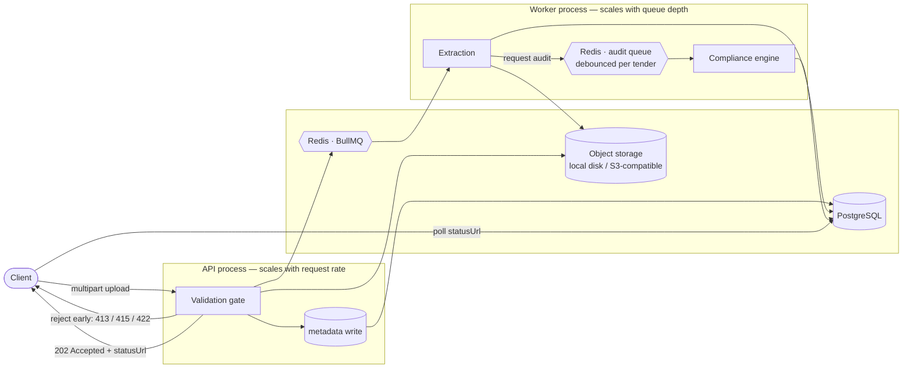

# Vantedge Bid — Tender Document Ingestion & Compliance Audit

A backend service for the two modules in the brief: **Tender Documents** and
**Compliance Audit**. Contractors upload the document package for a tender; the
service validates each file at the edge, processes it asynchronously, extracts
the fields that matter, and audits the package against a versioned ruleset
before the bid is submitted.

NestJS · TypeScript · PostgreSQL · Redis/BullMQ · S3-compatible storage · Docker Compose

**Documentation:** start at the [documentation index](docs/README.md) — numbered context documents (overview, domain, architecture, data model, ingestion, compliance, security, API, testing, operations, known gaps), the [ERD](docs/ERD.md), [ADRs](docs/adr/) and historical [reviews](docs/reviews/). AI-assisted work: see [CLAUDE.md](CLAUDE.md) and [AGENTS.md](AGENTS.md).

---

## Why these two modules belong together

Bids are routinely disqualified for clerical reasons. An SBU that expired two
days before the opening date. A certificate whose subclassification does not
match the announcement. A bid bond below the required percentage. A sister
company's NPWP on one page of the package.

None of these are hard to check. They are tedious, they are checked by hand
under deadline pressure, and the cost of missing one is the whole bid. So
ingestion is not a file-upload feature that happens to store PDFs — it is the
step that turns a pile of documents into facts the compliance engine can reason
about. The data model and the pipeline are both shaped by that.

---

## What runs, and what is only designed

Everything below the first line of this table is working code with tests behind
it. Everything below the second is reasoning about production, written down so
the design can be judged — not implemented, and not claimed to be.

| | Status |
|---|---|
| PostgreSQL schema, ERD, migrations | **Implemented** — 15 tables, applied by `npm run migrate` |
| Document ingestion REST API with size and format validation | **Implemented** — 8-stage gate, [below](#validation-gate) |
| Queue and worker, asynchronous processing | **Implemented** — BullMQ, separate process, with publish reconciliation |
| Content de-duplication and request idempotency | **Implemented** — claim, ownership and slot uniqueness are enforced by SQL; takeover recovery and explicit-slot validation are application logic in `DocumentsService`, verified by tests |
| Rule-based compliance engine over a versioned ruleset | **Implemented** — 10 evaluators, 12 seeded rules |
| Document field extraction | **Implemented, heuristic** — text-layer PDFs only, no OCR |
| OpenAPI documentation | **Implemented** — generated from the code at `/docs` |
| Tests | **Implemented** — 104 unit, 106 integration against a real database, queue and worker |
| — | — |
| AI-assisted document understanding | **Design only** — [Production vision](#production-vision--ai-assisted-compliance-auditing) |
| OCR for scanned documents | **Design only** |
| Human-in-the-loop review workflow | **Design only** |
| Authentication | **Out of scope** — [deliberately](#deliberate-scope-boundaries), with the seam left in place |

The brief asked for an ERD, an ingestion endpoint with basic validation, and a
written scaling strategy. This goes further than that in one specific direction:
the compliance engine actually runs, because a schema for compliance auditing
that has never evaluated a rule is a guess. Everything else is deliberately
bounded, and the boundaries are stated rather than left to be discovered.

---

## Quick start

```bash
cp .env.example .env
docker compose up -d --build        # postgres, redis, migrations, api, worker (local-disk storage)

npm ci
npm run seed                        # one organisation, one tender
npm run samples                     # nine sample documents, valid and invalid

open http://localhost:3000/docs     # OpenAPI
```

`npm run seed` prints ready-to-paste curl commands with real ids.

Running it without Docker needs Postgres and Redis on their default ports, then:

```bash
npm run migrate
npm run start:dev          # terminal 1 — API
npm run start:worker:dev   # terminal 2 — worker
```

---

## Architecture



Two processes, one codebase. The API admits work; the worker performs it. They
share entities, storage and the database, and they scale on different signals —
the API on request rate, the worker on queue depth. `WorkerModule` is the API's
module graph minus every controller, plus the queue processor.

### The request path

1. **Validate before anything expensive.** Checks run cheapest-first and stop at
   the first failure, so a 60 MB file is rejected on its size before anything
   hashes it.
2. **Write metadata, then bytes.** The version row is committed in `pending`
   *before* the upload. Storage is not transactional, so one of the two has to
   go first — and a crash mid-upload then leaves a visible, sweepable `pending`
   row rather than an orphaned object that nothing references and nobody ever
   finds. Prefer the failure you can see.
3. **Answer 202, not 200.** The response means *durably accepted*, not
   *finished*. It carries a `statusUrl` and a `jobId`.
4. **Process asynchronously.** Extraction and the compliance audit happen in the
   worker, at whatever rate the worker pool can sustain.

### Validation gate

Eight checks, in this order, each with its own error code so a client can act on
the result:

| # | Check | Rejects with |
|---|---|---|
| 1 | File present | `400 file_missing` |
| 2 | Non-empty | `400 file_empty` |
| 3 | Size, against the stricter of the global cap and the document type's own limit | `413 file_too_large` |
| 4 | Declared MIME type on this document type's allow-list | `415 unsupported_media_type` |
| 5 | **Magic bytes agree with the declared type** | `415 file_signature_mismatch` |
| 6 | Filename extension sanity | logged, not rejected |
| 7 | PDF not password protected | `415 file_encrypted` |
| 8 | SHA-256 content address computed | — |

Check 5 is the one that matters. Steps 4 and 6 both read client-supplied
metadata; a shell script renamed to `.pdf` and uploaded with
`Content-Type: application/pdf` passes both. The only trustworthy statement
about a file's type is in its own first bytes.

Check 7 looks ahead. An encrypted PDF uploads and stores perfectly, then yields
no text in the worker — turning a clear 415 at upload time into a mysterious
"processing failed" ten minutes later.

### Compliance engine

Rules live in the database; evaluators live in code. A rule row names an
evaluator (`not_expired_at_deadline`, `classification_match`,
`monetary_threshold`) and supplies its parameters as JSONB. Changing "KSWP must
be younger than 30 days" to 14 is an `UPDATE`, not a deployment.

The evaluator set is deliberately **closed** rather than an expression language.
A compliance product's job is to produce verdicts someone can defend; a DSL
produces verdicts nobody fully understands and inputs nobody has reviewed.

Evaluators are pure functions of a pre-loaded snapshot — no database, no clock,
no I/O. That keeps them unit-testable without a container and keeps the query
count independent of the rule count: twelve rules over thirty documents is four
queries, not three hundred and sixty.

**Audits triggered by ingestion are debounced.** Auditing inline, once per
ingested document, meant a 41-document upload session produced 41 full tender
audits and 2,193 finding rows — each one re-evaluating every rule against every
document. Audits are now requested per tender and published with a short delay,
so a burst collapses onto one pending audit; the survivor evaluates the tender's
state when it runs, which is everything the dropped requests would have seen.
Measured on the same 40-document burst: **1 audit, 33 finding rows.**

**The intent lives in Postgres, not in the broker.** Leaning on one
deterministic job id per tender is the obvious way to coalesce, and it is wrong
in two states a busy tenant reaches routinely. An add that arrives while the job
is *active* resolves to the running job and is dropped, so the document that
triggered it is never audited. A retained *failed* job holds that id for a week,
and the tender cannot be audited at all until it expires. Neither shows up in a
single-threaded test.

So `tender_audit_state` records per tender that an audit is owed (`pending`) and
which run is scheduled to carry it (`scheduled_job_id`, unique per run).
Requests coalesce by claiming that column with a conditional `UPDATE`, so
exactly one of several simultaneous callers publishes — the de-duplication
survives concurrency instead of depending on id collisions. A run takes the flag
*before* reading any documents, which turns "a document landed mid-audit" into a
fact rather than an inference. The run keeps `scheduled_job_id` for as long as
it is running, so a request arriving mid-audit finds the slot occupied: it sets
the flag and schedules nothing, which means a tender never has two ingestion-
triggered audits running at once. When the run ends, `finishRun` releases the
slot and reads the flag in one statement, and if a request arrived the processor
schedules one follow-up — which therefore starts after the active audit ended
and sees every document processed meanwhile. A run that fails *for good* (not a
retried attempt) restores the flag and frees its slot from the worker's `failed`
handler; the reconciler, or the next request, schedules a new run under a fresh
job id, so a retained failed job never blocks the tender. The reconciler also
schedules for any tender whose intent has no live job. The manual audit endpoint
is synchronous and bypasses all of this. This holds across several worker processes with no
shared timer and no in-memory state. The trade is explicit: an extra audit is
wasted work, a skipped one is a wrong verdict.

Findings are not binary. `inconclusive` exists because a compliance tool that
silently passes an unreadable certificate is worse than no tool at all.

---

## Data model

Fifteen domain tables (the migrator also keeps its own `schema_migrations`
bookkeeping table, which is not part of the model). Full ERD, relationship
explanations and the reasoning behind each decision:
**[docs/ERD.md](docs/ERD.md)**.

The schema is built by six forward-only migrations in `db/migrations/`, applied
in order by `npm run migrate`; the migrator checksums applied files and refuses
a changed one.

| Migration | Adds |
|---|---|
| `001_init_schema.sql` | the original 14 domain tables, enums, indexes |
| `002_seed_reference_data.sql` | document types, ruleset v1 and its rules |
| `003_ingestion_job_publication.sql` | `ingestion_jobs.published_at` and the outbox index |
| `004_reliability_corrections.sql` | `idempotency_keys.owner_token`, `document_types.allows_multiple`, `tender_audit_state` |
| `005_correct_schema_comments.sql` | comment corrections only, no structural change |
| `006_idempotency_operation_link.sql` | `idempotency_keys.version_id` |

The four load-bearing ideas:

- **`tender_documents` (slot) is separate from `document_versions` (file).** A
  correction is a new version, never an overwrite, so nothing a past audit cited
  can change underneath it.
- **`checksum_sha256` is unique per document slot**, not per tenant. The scope
  is the whole point: a contractor submits the same SBU to every tender they
  bid for, so tenant-wide uniqueness made the second tender's upload look like
  a duplicate and discarded it. Repeat uploads into *one* slot are still caught
  by the database rather than by convention, which is what makes the ingestion
  endpoint safely retryable, and storage de-duplication is preserved separately
  through content-addressed object keys.
- **Rulesets are versioned and findings snapshot their severity.** Regulation
  changes. Without this, a verdict rendered in March quietly means something
  different in September, and the product cannot defend its own history.
- **`audit_trail` is append-only by convention.** Mutable rows answer "what is
  true now"; the trail answers "who changed what, when". A compliance product
  needs both. Nothing in the database enforces it yet — see
  [known gaps](#known-gaps-stated-rather-than-discovered).

---

## API

All endpoints are tenant-scoped through `X-Organization-Id`. Errors are
[RFC 7807](https://www.rfc-editor.org/rfc/rfc7807) problem details with an
additional machine-readable `code`.

| Method | Path | Purpose |
|---|---|---|
| `POST` | `/v1/tenders` | Register a tender |
| `GET` | `/v1/tenders/:id` | Tender with its document slots |
| `POST` | **`/v1/tenders/:id/documents`** | **Ingest a document** |
| `GET` | `/v1/documents/versions/:id/status` | Processing status + extraction |
| `POST` | `/v1/tenders/:id/compliance-audits` | Run an audit |
| `GET` | `/v1/compliance-audits/:id` | Full report, worst findings first |
| `GET` | `/v1/document-types` | Reference data and upload limits |
| `GET` | `/healthz` · `/readyz` · `/metrics/queue` | Probes and queue depth |
| `GET` | `/v1/demo/organizations` | **Demo only**, off by default — [see below](#demo-organization-directory) |

### Demo Organization Directory

Every tenant-scoped endpoint needs an `X-Organization-Id` header, and there is no organisation management in this project. To make the API easy to try, one **read-only** endpoint lists the organisations in the database:

```
GET /v1/demo/organizations?limit=50&offset=0
```

It returns only `id`, `slug`, `name` and `createdAt` (never NPWP, NIB or anything else), newest first, with `pagination: { total, limit, offset }`. `limit` defaults to 50 (maximum 100), `offset` to 0; anything invalid is a `400`. It never creates or changes data and needs no header.

**It is off by default and is not authentication.** It exists only when `DEMO_MODE=true` *and* `NODE_ENV` is `development`, `test` or `demo`. Otherwise it answers `404`, exactly like a route that does not exist, and the application **refuses to start** with `NODE_ENV=production` and `DEMO_MODE=true` (or any `DEMO_MODE` other than `true`/`false`). `X-Organization-Id` remains a simulated tenant context; production would still need real authentication and authorisation ([security notes](docs/07-security-and-tenancy.md)).

Try it:

```bash
# 1. in .env (copied from .env.example):  DEMO_MODE=true   (NODE_ENV=development)
npm run seed                    # creates the demo organisation (idempotent)
npm run start:dev               # API on :3000
# 2. open http://localhost:3000/docs → the "Demo" tag → GET /v1/demo/organizations → Execute
# 3. copy an `id` into the X-Organization-Id header of the tenders / documents endpoints
```

With Docker, the API container runs as `production` by default, which keeps the endpoint unavailable. To enable it, add `DEMO_MODE=true` and `API_NODE_ENV=demo` to `.env` and run `docker compose up -d --build`. The endpoint reflects whatever is in PostgreSQL; it does not seed anything itself.

### Ingest a document

```bash
curl -i -X POST http://localhost:3000/v1/tenders/$TENDER_ID/documents \
  -H "X-Organization-Id: $ORG_ID" \
  -H "Idempotency-Key: $(uuidgen)" \
  -F 'documentTypeCode=SBU' \
  -F 'file=@samples/sbu-valid.pdf;type=application/pdf'
```

```http
HTTP/1.1 202 Accepted
Location: /v1/documents/versions/8f0c.../status
```

```json
{
  "documentId": "4b1e...",
  "versionId": "8f0c...",
  "versionNo": 1,
  "lifecycle": "queued",
  "checksum": "9f2b...",
  "documentTypeCode": "SBU",
  "sizeBytes": 1184,
  "jobId": "ingest-8f0c...",
  "statusUrl": "/v1/documents/versions/8f0c.../status",
  "deduplicated": false
}
```

### A failing audit

Illustrative and abbreviated (two of the findings shown). `totals.rules` counts findings, not rules; the score is `(passed + 0.5 × warnings) / (passed + failed + warnings) × 100`. A response captured from a live run is in the walkthrough deck (`docs/presentation/`).

```json
{
  "verdict": "non_compliant",
  "score": "70.83",
  "totals": { "rules": 14, "passed": 8, "failed": 3, "warnings": 1 },
  "findings": [
    {
      "rule": "SBU.NOT_EXPIRED",
      "severity": "blocker",
      "status": "fail",
      "message": "Sertifikat Badan Usaha Konstruksi expires on 2026-12-10, 5 day(s) before the submission deadline.",
      "evidence": { "expiresAt": "2026-12-10", "deadline": "2026-12-15T10:00:00.000Z", "marginDays": -5 }
    },
    {
      "rule": "BOND.AMOUNT_SUFFICIENT",
      "severity": "blocker",
      "status": "fail",
      "message": "Bid security of Rp 90.000.000 is below the required 1% of the package value (Rp 150.000.000).",
      "evidence": { "amount": "90000000.00", "requiredMinimum": "150000000.00" }
    }
  ]
}
```

Every finding carries its `evidence` — whatever the evaluator actually looked
at, so a human can check its work rather than trust it.

### Error codes

`file_missing` · `file_empty` · `file_too_large` · `unsupported_media_type` ·
`file_signature_mismatch` · `file_encrypted` · `duplicate_document` ·
`idempotency_key_reused` · `idempotent_request_in_progress` ·
`tender_not_found` · `document_type_not_found` · `tender_deadline_passed` ·
`storage_unavailable` · `queue_unavailable` · `internal_error`

Clients branch on the code, never on the message. 5xx responses never echo an
internal message; the detail is logged against the request id instead.

### Idempotency

Send an `Idempotency-Key` header and a retry after a timeout is safe. What makes
it safe is that the key alone is not what identifies the request:

- **Same key, same request** → the stored response, with `Idempotent-Replay: true`.
  "Same request" means the same tender, the same form fields *and* the same file
  bytes, fingerprinted together.
- **Same key, different request** → `409 idempotency_key_reused`. Replaying the
  first response here would tell a caller their NIB upload succeeded when what
  is stored is an SBU. Refusing is the only honest answer.
- **Same key, same request, still running** → `409 idempotent_request_in_progress`.
  The key is claimed with a conditional `INSERT` before the work starts, so two
  concurrent retries cannot both proceed — check-then-act would let them.
- **Failed attempt** → a claim whose request created nothing is released, so the
  key is free for the corrected upload rather than locked for 24 hours. A claim
  whose request already filed a version is *not* deleted — that would let the
  retry file the document again — but handed back as immediately takeable with
  the version still attached (see below).
- **Crashed attempt** → a claim with no response is a request in flight, and a
  process that dies mid-request leaves one behind. After a **two-minute lease**
  (`IDEMPOTENCY_CLAIM_LEASE_MS`) the *same* request may take it over, so a crash
  blocks a retry for minutes rather than a day. A *different* request never
  inherits a stale key — it still gets `409`. Taking over is safe because the
  retry does not redo the work: the claim records the version its request
  created (`idempotency_keys.version_id`, migration 006), and the takeover
  recovers that version instead of filing another.

**Claims have an owner, not just an age.** Every acquisition mints an
`owner_token`, and completing or releasing a claim is conditional on still
holding it. Without that, a request whose lease lapsed while it was merely slow
could come back and delete its successor's claim, or write its own response
under it — handing the next caller someone else's answer. Losing the race is not
an error for the slow request: its own work succeeded and its own response is
returned, it simply does not get to record it.

**Claims remember the operation they began.** `version_id` is written in the
same transaction that creates the `document_versions` row, conditional on
`owner_token`, so "the claim names a version" and "the version exists" commit
together or not at all; a request that lost its claim fails that write and its
transaction rolls back, creating nothing. A takeover by the same request
fingerprint receives the `version_id` and recovers that version through the
normal resume path (a version whose object-store write failed is reopened to
`pending` first). The checksum plays no part: for `SKK_PERSONIL` two
byte-identical files are two documents, so only request identity can tell a
retry from a second submission. A takeover by a *different* fingerprint is
refused, and a key whose response was already recorded starts clean when it
expires. This is an application-level guarantee built from a foreign key and a
conditional write; the database does not stop code that bypasses `DocumentsService`.

The lease is a timeout, and the ownership token is what makes a wrong timeout
safe rather than corrupting. That is why the lease was not simply lengthened:
two minutes comfortably exceeds the work remaining after validation — an object
write and two short transactions, bounded by the 50 MiB ceiling — and if it ever
proves too short, the consequence is a redundant takeover rather than a
mis-attributed response.

There are three separate anti-duplication mechanisms, at three layers, and none
replaces another: the idempotency key guards the *request*, the deterministic
BullMQ job id guards the *job*, and the unique index on
`(document_id, checksum_sha256)` guards *the same content in the same slot*.

### De-duplication is scoped to the document slot

Worth stating precisely, because getting the scope wrong is costly. The same
bytes uploaded **to the same slot** are a retry. The same bytes uploaded **to a
different tender** are a different document and must be recorded as one.

A contractor submits one SBU, one NIB and one NPWP to every tender they bid for
— that is the normal case, not an edge case. Scoping de-duplication to the
tenant therefore discarded the second tender's upload while answering `202`, and
the audit then reported the document as never uploaded. The index now lives on
`(document_id, checksum_sha256)`.

The same reasoning applies one level further in. When the caller does not name a
slot, a repeat is identified by **tender + document type + bytes**, not by bytes
alone: a company deed filed as `AKTA_PENDIRIAN` and then as `PENGALAMAN_KERJA`
is two filings of one file, not one filing done twice. When the caller *does*
name a slot with `documentId`, the slot must belong to that tender and hold that
document type — otherwise a file would end up filed under a type the compliance
engine will not evaluate it as.

### Four identities, deliberately kept apart

| Identity | Established by | Answers |
|---|---|---|
| HTTP request | `Idempotency-Key` + request fingerprint | "have I already handled this call?" |
| Logical document | `tender_documents` row | "which requirement is this for?" |
| Version | `document_versions` row | "which submission of it?" |
| Content | `checksum_sha256` | "which bytes?" |

**A checksum identifies content, not a submission**, and the two part company
for types a tender holds more than once. `document_types.allows_multiple` marks
those — `SKK_PERSONIL`, `SURAT_DUKUNGAN` — and for them identical bytes are two
submissions, because two key personnel can hold byte-identical certificates and
collapsing them would lose one person's qualification. A repeat there is
established by an `Idempotency-Key` or an explicit `documentId`, not by the
hash.

An explicit `documentId` is validated **before** any content-based retry lookup:
the slot must exist, belong to this tender and organisation, not be deleted, and
hold the requested `documentTypeCode`. (`loadExplicitSlot`, called from `persist`
and again inside the filing transaction.) Otherwise an SBU upload aimed at the
NIB slot with the NIB's bytes would match the NIB version and be answered as a
valid repeat. For a single-instance type the hash is sufficient: there is only one such
document, so the same bytes can only be it arriving twice.

Slot allocation is serialised with a Postgres advisory lock on
`(tender, document type)`. A row lock cannot help, because the contended case is
an *empty* result — two concurrent uploads both finding no slot and both
creating one, or both taking the one pre-opened slot and filing one person's
certificate as a revision of another's.

`current_version_id` only ever moves forward. Storage completion order is not
request order, and an unconditional update lets a slow older upload walk the
pointer back to the superseded file — which is then what the compliance engine
evaluates.

Storage is still de-duplicated: object keys are content-addressed per tenant, so
one certificate across twelve tenders is **one object and twelve version rows**.
The second upload writes a row and no bytes.

Reuse is decided by asking **storage**, not the database. A `document_versions`
row is written before its bytes are, so a row can exist for an object that was
never successfully stored — and trusting the row would skip the write and queue
a worker against a missing file. The check compares the stored object's size
against the upload's, because an object truncated by a failed write is present
but unusable. The local driver writes through a temporary file and renames into
place, so a concurrent reader sees a complete object or none; S3 PUT is already
atomic.

---

## Scalability — thousands of documents at once

### The shape of the load

The load is not uniform. Tender deadlines cluster: an announcement closes at
10:00, and the packages for it arrive in the preceding two hours. A contractor
pursuing fifteen tenders uploads two hundred documents in an afternoon. The
system is quiet, then it is not.

That rules out sizing for the average. Three properties matter instead:

1. **Admission must never fail under burst.** Losing an upload at 09:52 on
   deadline day is the worst outcome the system can produce.
2. **Processing may lag; it must not drop.** A two-minute delay on extraction is
   invisible to the user. A lost document is not.
3. **One tenant's burst must not starve another's.**

### 1 · Decouple admission from processing

The endpoint returns `202 Accepted` as soon as the file is durably stored and
the job is queued. Admission costs a validation pass, an object write and an
enqueue — bounded, predictable work. Extraction, which is CPU-bound and variable
(a two-page certificate versus a four-hundred-page method statement), happens
behind the queue.

Without this, a slow document holds an HTTP connection open and admission
capacity collapses exactly when it is needed.

### 2 · Take the bytes off the API path

Multipart through the API is the honest MVP, and it is the first thing to hit a
ceiling: 5,000 documents averaging 2 MB is 10 GB of request body through
processes whose job is to make decisions, not to move bytes.

The production path is already modelled —
`StorageService.createUploadUrl()` issues a pre-signed PUT:

```
client → POST /documents/intent   → { uploadUrl, versionId }   (API: one row, no bytes)
client → PUT  uploadUrl           → object storage             (API not involved)
storage event / client confirm    → enqueue
```

The API then handles a few hundred bytes per document instead of two megabytes,
and upload throughput becomes the object store's problem — which is what object
stores are for. The abstraction exists so this is a routing change, not a
rewrite.

### 3 · Queue and workers

**Publish after commit.** The `ingestion_jobs` row is written and committed
*before* the job is published. The row is the record of intent; the publish acts
on it. Publishing first lets a worker start against state that is not yet
durable — it drove documents to `processed` and the API's later commit then
overwrote that back to `queued`, stranding 24% of a 40-upload burst as
"permanently queued" with a completed extraction. If the publish fails after the
commit, the row sits in `queued` with no live job — visible, and recovered two
ways.

**Recovery when the publish never happens.** `ingestion_jobs.published_at`
records publication as a durable fact, so a `queued` row with
`published_at IS NULL` is committed intent the broker never heard of.
`IngestionReconciler` sweeps those on an interval and republishes them. It runs
in both the API and the worker and claims rows with `FOR UPDATE SKIP LOCKED`, so
several instances divide the backlog instead of contending or double-publishing.

**`pending` and `queued` are recovered differently**, because they are not the
same kind of unfinished. A `queued` version has been promoted — lifecycle
committed, slot pointing at it, ledger row present — so only the publish can be
missing. A `pending` version has none of that, and publishing it bare hands a
worker a version with no ledger row to update and a slot still pointing
elsewhere; the extraction then lands on a document the tender does not
reference. A retry on a `pending` version therefore runs the full promotion
path, with the ledger insert as `ON CONFLICT DO NOTHING` so repeating it stays
idempotent.

Promotion is a **conditional transition**: `UPDATE document_versions SET
lifecycle = 'queued' WHERE id = $1 AND lifecycle = 'pending'`. Two recovery
requests can read the same pending version; the update takes the row lock, so
the second waits and then re-evaluates against what the first committed. Only
the request that performed the transition moves the slot pointer, writes the
ledger row and publishes; the other returns the lifecycle that is actually
persisted (`processed`, if a worker already finished). Without the condition a
stale request wrote `queued` over `processed`. Terminal states — `processed`, `failed`, `quarantined` — are left
alone; quarantine in particular is a decision not to retry.
Republishing is a no-op when the job is in fact live, because the job id is
deterministic. A client retry repairs the same state sooner via
`resumeIfStalled`; the reconciler covers the common case where nobody retries,
which is most of them — a client that got no response usually gives up rather
than repeating itself.

`ingestion_jobs` is the outbox. It already existed; `published_at` was the only
thing it was missing. No relay framework was added.

**Deterministic job ids.** The job id is `ingest-<versionId>` — derived from the
version, because the version is the unit of work. (A content-derived id looks
tempting until one certificate goes to two tenders: two versions, two extraction
rows, one id, collision.) A retried request resolves to the version it already
created and therefore to the same job id, which BullMQ ignores as a duplicate.
Combined with the slot-scoped checksum index, delivery is at-least-once and
*effect* is exactly-once.

**Priority by document class.** Qualification documents (SBU, SKK, KSWP) gate the
whole bid and are small; technical attachments are large and can wait. Under a
flood, the time-critical checks stay responsive while 50 MB method statements
queue behind them.

**Retries that distinguish fault classes.** Exponential backoff from 2 s, five
attempts, for transient faults — a storage blip clears in seconds, a dependency
outage needs minutes. But an unreadable scan is *terminal*: it is thrown as
`UnrecoverableError`, quarantined, and taken out of the retry loop immediately.
Retrying a document that will never parse four more times is how a queue spends
its capacity on work that cannot succeed.

**Dead letter with a durable trail.** `ingestion_jobs` mirrors every job into
Postgres with attempts, duration and error class. Redis trims completed jobs;
this table is what answers "which documents failed last Tuesday and why".

**Horizontal workers.** `docker compose up -d --scale worker=8`. Nothing in the
worker is singleton-bound. Concurrency within a worker is for I/O overlap
(storage reads); parallelism across workers is for CPU.

**These figures are an arithmetic projection, not a measurement.** They assume
~400 ms of CPU per document and linear scaling, and neither has been benchmarked
here. They are included to show the shape of the calculation; treat them as a
sizing starting point to be replaced by a real load test.

| Workers × cores | Projected throughput | 5,000 documents |
|---|---|---|
| 1 × 2 | ~5/s | ~17 min |
| 4 × 2 | ~20/s | ~4 min |
| 8 × 2 | ~40/s | ~2 min |

What *has* been measured is the correctness of the pipeline under concurrency:
`test/integration/worker-pipeline.spec.ts` runs the API and a real worker
together and asserts that every concurrently uploaded document reaches a
terminal, self-consistent state.

### 4 · Fairness between tenants

Priority alone does not stop one organisation's 5,000-document import from
sitting in front of everyone else's deadline-day uploads. Two mechanisms:

- **Admission throttling per tenant** — a token bucket at the API, so a bulk
  import is paced into the queue rather than dumped into it.
- **Separate queues per workload class** — interactive uploads and bulk imports
  on different queues with their own worker pools, so a bulk backlog cannot
  occupy the consumers that deadline-day traffic needs. (BullMQ Pro offers
  per-key groups; the open-source equivalent is queue separation, which is why
  `queue_name` is a column on `ingestion_jobs` rather than a constant.)

### 5 · The database is the next ceiling

Scaling workers scales database connections, and that ceiling arrives sooner
than people expect:

```
connections = (api_replicas × pool) + (worker_replicas × pool)
```

At `DATABASE_POOL_SIZE=6`, twenty workers is 120 connections — past the default
`max_connections` of 100. The service would then fail at the database while the
queue looks healthy. Mitigations, in the order they should be reached for:

1. Keep worker pools small (6 is configured, not accidental).
2. **PgBouncer in transaction mode** — the standard answer, and what Supabase's
   pooled connection string already gives you on port 6543.
3. **Batch the writes.** Findings are inserted in one statement per audit, not
   one per finding.
4. **Partition the append-heavy tables.** `document_versions`,
   `compliance_findings` and `audit_trail` are range-partitioned by month once
   they outgrow a single heap. The indexes already lead with tenant or parent,
   so partition pruning works without a query rewrite.
5. **Read replica for reporting.** Dashboard queries have no business competing
   with the ingestion write path.

### 6 · Backpressure, not collapse

A system that accepts work it cannot perform converts a throughput problem into
an outage. `/metrics/queue` exposes depth by state; when depth or oldest-job-age
crosses its threshold the correct responses, in order, are: scale workers,
throttle bulk tenants, and only then shed with `429` and `Retry-After`. Shedding
an upload is a real cost, so it is the last resort — but an unbounded queue is a
worse one.

### 7 · What to watch

| Signal | Why it is the one that matters |
|---|---|
| Queue depth & **oldest job age** | Depth alone hides a stuck job; age does not |
| p95 time from upload to `processed` | The number the user actually experiences |
| Dead-letter rate by `error_class` | Separates a bad deploy from bad documents |
| Rejection rate by error code | A spike in `file_signature_mismatch` is usually a broken client |
| Postgres connection saturation | The ceiling that arrives before CPU does |

Every log line carries a request id, propagated from the API into the worker, so
a single upload is traceable end to end.

---

## Production vision — AI-assisted compliance auditing

**None of this section is implemented.** It is here because the MVP's shape was
chosen with it in mind, and because the interesting question about an AI
compliance product is not whether you can call a model — it is what you refuse
to let the model decide.

### Where AI helps, and where it must not

The rules in this service are deterministic because the conditions they test
are. "Does this certificate expire before the submission deadline?" has one
correct answer, computable from two dates, reproducible forever. Routing that
through a language model would make a verdict that used to be provable into one
that is merely likely.

What deterministic rules cannot do is read a requirement like:

> Penyedia jasa harus memiliki pengalaman melaksanakan sekurang-kurangnya dua
> proyek pembangunan gedung dengan nilai kontrak minimal Rp10 miliar dalam lima
> tahun terakhir.

against a forty-page experience record. That is comprehension over unstructured
text, and it is where a model earns its place.

So the split is not "AI instead of rules". It is:

| Layer | Does | Must never |
|---|---|---|
| Extraction | Turn documents into fields, with OCR and a model where parsers fail | Decide compliance |
| Deterministic rules | Evaluate conditions that have a provable answer | Be overridden by a model |
| AI analysis | Interpret requirements that rules cannot express | Produce a `pass` on its own |
| Human review | Resolve low-confidence and high-severity findings | Be bypassed when the model is confident |

### What would change in the schema

Very little, which is the point of having built it this way:

- **`compliance_findings.evidence` already exists** and is already populated by
  every evaluator. An AI finding would carry its source document, page and the
  quoted span in the same column. A finding nobody can trace to a document is
  not admissible, whether a model or a regex produced it.
- **`finding_status.inconclusive` already exists.** A model's low-confidence
  answer maps onto it directly, rather than needing a new "maybe" state bolted
  on later.
- **Rulesets are already versioned**, so a model version and prompt revision
  would be recorded the same way a rule threshold is — a verdict stays
  explainable after the model is upgraded.
- **`document_extractions.extracted_data`** is where model-extracted fields
  would land, under the same promotion rule as every other extracted field.

The one genuine addition is a `review_queue`: findings routed to a human, with
who reviewed them and what they decided. That is a table and a workflow, not a
redesign.

### Production considerations

- **Model output is validated against a schema before it is persisted.** An LLM
  that returns prose where a date was expected must fail loudly, not write a
  null that a later rule reads as "no expiry found".
- **A model failure must never produce a compliant verdict.** Timeouts, refusals
  and malformed output all resolve to `inconclusive`, which routes to review.
  The failure mode of an AI compliance tool has to be "I could not check this",
  never "looks fine".
- **Confidence is a routing signal, not evidence.** `0.87` means the model was
  asked to guess how sure it is. It decides whether a human looks at the
  finding; it does not substitute for the finding's own evidence.
- **Tender documents are commercially sensitive.** Sending them to a third-party
  model is a data-residency and retention decision before it is a technical one,
  and for some buyers it will be the reason to run a model in-tenant instead.

### How I would sequence it

1. OCR behind the existing extractor interface — the largest accuracy win, no
   new decision authority, and it makes the `quarantined` scans usable.
2. Model-assisted field extraction for document types whose layout defeats the
   parsers. Still feeding the same deterministic rules.
3. Requirement interpretation: parse the tender announcement itself into
   candidate rules, reviewed by a human before they become a ruleset version.
4. AI analysis of requirements no rule expresses, writing `inconclusive`
   findings with evidence, routed to review.

Each step is useful on its own, and none of them moves a `pass` decision from
code into a model.

---

## Project structure

```
src/
├── common/              errors, RFC 7807 filter, guards, decorators
├── config/              typed configuration + fail-fast env validation
├── database/            entities, enums, SQL migration runner
├── storage/             StorageService abstraction, S3 and local drivers
├── modules/
│   ├── tenders/
│   ├── documents/       ingestion endpoint + the validation gate
│   ├── ingestion/       queue, worker processor, extraction
│   ├── compliance/      audit service + evaluator registry
│   └── health/
├── main.ts              API entrypoint
└── worker.ts            worker entrypoint
db/migrations/           the schema — source of truth (ADR 0001)
docs/                    numbered context docs (00–11), ERD, ADRs, historical reviews
.claude/                 project subagents and scoped rules for Claude Code
CLAUDE.md, AGENTS.md     project instructions and shared engineering guidance
test/                    unit tests + fixtures
```

---

## Tests

```bash
npm test            # 104 unit tests, no services required (Jest runs serially: see jest.config.js)
npm run typecheck   # tsc --noEmit, strict

# + 106 integration tests against a real database, queue and worker (210 total)
DATABASE_URL=postgres://... REDIS_URL=redis://... npm test
```

**Unit tests** cover the logic that is wrong-or-right on its own: the validation
gate including a disguised-file case, the Indonesian date and NPWP extraction,
the request fingerprint, and the compliance evaluators — including the
exact-threshold bid bond and a value past `Number.MAX_SAFE_INTEGER`, where a
float comparison would pass a bond that is short.

Fixtures generate real PDF bytes rather than asserting against hand-written
buffers, so the parser is genuinely exercised.

**Integration tests** cover the claims that only hold if several components
agree, and that a unit test with a mocked repository would happily confirm while
production disagreed:

- the request path persisting what it says it persisted — version row, slot
  pointer, queue job and audit trail entry
- versioning driven by content, not by the caller: identical bytes de-duplicate,
  different bytes become version 2, and version 1 survives
- idempotency across a repeat, a conflicting reuse, and a failed attempt
- **tenant isolation** — organisation B gets `404`, not `403`, on A's tender,
  document status and audits. This README claims isolation; this is where that
  claim is checked rather than asserted.
- **the same certificate filed against two tenders** — both slots filled, two
  version rows, one stored object.

`test/integration/recovery.spec.ts` covers the windows between systems that
cannot be made atomic: a version row whose object was deleted or truncated,
three identical uploads racing for one object key, a job committed but never
published, a reconciliation pass running twice, and an idempotency claim left
behind by a process that died.

The reliability-correction suites each target one defect and drive the real
service or processor, not restated SQL:

- `idempotent-takeover.spec.ts` — crash after the version is filed, expire the
  lease, retry: one document, one version, one ledger row, the original version
  returned; a stale owner cannot complete or release its successor's claim; a
  different fingerprint cannot take over; a failed object-store write recovers
  without a second document.
- `explicit-slot.spec.ts` — an explicit `documentId` with a mismatched type and
  matching checksum is rejected; wrong tender, wrong organisation and deleted
  slots are refused.
- `concurrent-promotion.spec.ts` — two concurrent recoveries of one pending
  version with a real ingestion worker; barriers force both to read `pending`
  and the second to promote only after the worker finished. The lifecycle is
  sampled throughout and never regresses.
- `audit-followup.spec.ts` — real audit worker, one audit held open: a document
  processed meanwhile records durable intent, no parallel audit starts, the
  follow-up runs after the first ended and includes the new document, the first
  audit stays in history, and nothing more runs when nothing more is requested.
  Also: a terminally failed job (checked by its real id being in BullMQ's
  `failed` set) is retried by the reconciler and by a fresh request.

`test/integration/audit-isolation.spec.ts` replaces the worker's compliance
service with one that always throws, then checks the ingestion outcome for
damage: the document stays `processed`, the job stays `completed` with one
attempt, the audit failure is visible, and the tender audits cleanly afterwards.

`test/integration/worker-pipeline.spec.ts` goes further and runs the API **and a
real worker together** under concurrent load. It exists because the other
integration suite asserts state immediately after upload and therefore has to
assume nothing is consuming the queue — an assumption untrue of every real
deployment, and the one that hid the publish-before-commit race. It asserts that
every concurrently uploaded document reaches a terminal state and that the
document, its job row and its extraction agree with each other. Reverting the
publish ordering makes it fail, which is the only reason to trust it.

`test/integration/schema-drift.spec.ts` additionally selects one row through
every entity against a migrated database. Because the entities are a
hand-written mapping over SQL the ORM did not generate (ADR 0001), that is what
turns a renamed column into a build failure instead of a 500 on whichever
endpoint touches it first.

### A test only counts if it fails on the broken version

Every regression test here was checked by reverting the fix and confirming the
test goes red. That is not ceremony; three of these tests did not fail on the
broken code when first written, and one of them had already been written off as
proof:

- **The audit-coalescing test went through `requestAudit`,** whose own
  "is anything scheduled?" pre-check won the race before the claim inside
  `schedule()` was ever contended. Reverting that claim left the suite green.
  The suite now races `schedule()` directly, which is also how the reconciler
  and the processor's follow-up reach it.
- **The claim-ownership test re-typed the service's SQL** and so only proved
  that Postgres honours an equality predicate. Removing the ownership condition
  from `completeClaim` and `releaseClaim` changed nothing. The test now calls
  the service.
- **The advisory lock could be deleted outright** with every slot-allocation
  test still passing: most of a request is synchronous work before the
  transaction opens, so one upload usually finishes before the next handler is
  scheduled. Racing two transactions was no better — whether the overlap lands
  on the critical instant varies between runs, and a test that passes against
  broken code most of the time is worse than no test. The suite instead asks a
  second connection, with `pg_try_advisory_xact_lock`, whether the lock on that
  `(tender, document type)` is held during allocation and free after commit.
  That answer is exact.

This pass's regression tests were each run against a deliberate mutation and
failed: ignoring `version_id` on takeover (2 fail), removing the explicit-slot
check (1 fails), dropping the `lifecycle = 'pending'` condition (2 fail),
removing the processor's follow-up (2 fail), and freeing the job slot at run
start as the old `claimPending` did (1 fails). One earlier assertion could not
fail at all: `audit-isolation.spec.ts` looked a job up by `tenderId`, but job ids
are `audit-<tenderId>-<uuid>`, so the lookup returned `null` and the test
accepted `['failed', null]`. It now finds the real job in the failed set.

Two mechanical notes, because they cost time here. A mutation has to be *valid*
SQL: dropping `AND owner_token = $3` while still passing the parameter produces
a bind-count error, and six tests then fail for a reason that has nothing to do
with ownership — which reads exactly like a test catching the bug. And
mutation runs need `--no-cache`; a cached transform made one mutation look
survivable twice before.

The integration suites skip themselves when `DATABASE_URL` is unset, so the unit
suite stays runnable with nothing installed. CI runs everything.

---

## Deliberate scope boundaries

Stated rather than left for a reviewer to infer:

- **No authentication.** `OrganizationContextGuard` reads a header and produces
  exactly the shape a JWT guard would. Every tenant-scoped query already filters
  by `organization_id`, so swapping the guard is the whole of the auth work —
  no controller or service signature moves.
- **Extraction is heuristic.** It reads uncompressed and FlateDecode PDF streams
  and applies Indonesian-keyword field patterns. It does not do OCR. A scan
  yields no text, is quarantined, and surfaces as a `DOC.READABLE` finding —
  visible rather than silently passed. Production would put pdfjs or Tika behind
  the same function signature.
- **Auditing is a separate failure domain.** Audits triggered by ingestion run
  on their own queue, so an audit that throws fails its own job and is recorded
  as a failed `compliance_audits` row — it cannot mark the document failed or
  make BullMQ retry the extraction. The manual audit endpoint is still
  synchronous, because it is a pure in-memory evaluation over an already-loaded
  snapshot and the caller is waiting for the answer.
- **OOXML files are detected as ZIP containers.** `.xlsx` and `.docx` are
  indistinguishable by magic bytes; telling them apart means reading
  `[Content_Types].xml`, which belongs in the worker, not the request path.

### Known gaps, stated rather than discovered

These are real and unfixed. They are listed because a reviewer should not have
to find them, and because a schema that has a column for something is not the
same as a system that does it.

- **No scheduler.** `compliance_audits.trigger` accepts `scheduled` and
  `deadline_approaching`, and nothing in the service ever produces them. An
  audit runs on upload or on request. **A certificate that expires while sitting
  in a complete bid package is therefore not noticed until something else
  triggers a re-audit.** Closing this needs a repeatable BullMQ job or
  `@nestjs/schedule`; the trigger values and audit history already support it.
- **Ruleset immutability is a convention, not a constraint.** Nothing prevents
  an `UPDATE` to a ruleset an audit has already cited, which would silently
  change what that audit meant. The reproducibility argument in ADR 0003 holds
  only as long as nobody does that. Enforcing it needs a trigger.
- **`audit_trail` is append-only by convention.** No grant or trigger prevents
  `UPDATE` or `DELETE`.
- **Tenant integrity is not enforced by foreign key.** Child rows carry
  `organization_id` alongside a parent reference, and nothing makes the two
  agree; a service bug could write a cross-tenant row the database would accept.
  Composite foreign keys would close this.
- **No malware scanning.** The `quarantined` lifecycle is for documents that
  were read and found unusable — no text layer, corrupt, encrypted. It is not an
  infection verdict.
- **No pagination.** List endpoints are capped at 100 tenders and 20 audits with
  no parameters and no total count.
- **No rate limiting.** The upload endpoint is unbounded per tenant.
- **Pre-signed upload URLs are modelled, not wired up.**
  `StorageService.createUploadUrl` exists and is described above as the
  production path for large files, but no endpoint calls it and no test covers
  it.

## Decisions

- [ADR 0001 — SQL-first schema, ORM as a mapping layer](docs/adr/0001-sql-first-schema.md)
- [ADR 0002 — Asynchronous ingestion behind a queue](docs/adr/0002-async-ingestion.md)
- [ADR 0003 — Rules as data, evaluators as code](docs/adr/0003-rules-as-data.md)
- [ADR 0004 — Hybrid storage for extracted fields](docs/adr/0004-hybrid-extraction-storage.md)
- [ADR 0005 — Compliance audits on their own queue](docs/adr/0005-audit-on-its-own-queue.md)

## Supabase mapping

The schema is plain PostgreSQL and applies to Supabase unchanged.

- **Isolation** — **RLS is not implemented.** There is no `CREATE POLICY` in
  this repository; tenant isolation today is enforced entirely in application
  queries and verified by integration test, not at the database boundary.

  When it is added, it will not be one uniform policy per table. Most tenant
  tables carry `organization_id` and take the simple form
  (`organization_id = auth.jwt() ->> 'org_id'`), but `document_extractions` and
  `compliance_findings` have no such column — they are reached through their
  parent — so those need join-based policies, which are more expensive and must
  be index-supported. `document_types`, `compliance_rulesets` and
  `compliance_rules` are global reference data and are excluded by design.
- **Connections** — use the pooled connection string (port 6543, PgBouncer
  transaction mode) for workers; the direct connection for migrations.
- **Storage** — Supabase Storage is S3-compatible, so `STORAGE_ENDPOINT` and
  credentials are the only change. No application code moves.
