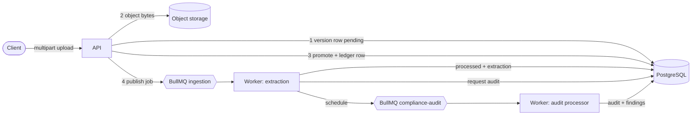

# 03 — System architecture

**Purpose:** processes, queues, data flow and failure boundaries. **Related:** [05](05-document-ingestion.md), [06](06-compliance-engine.md), [10](10-deployment-and-operations.md); scaling reasoning lives in the [root README](../README.md#scalability--thousands-of-documents-at-once).
**Sources:** `src/main.ts`, `src/worker.ts`, `src/worker.module.ts`, `src/modules/ingestion/*`, `src/modules/compliance/*`, [ADR 0002](adr/0002-async-ingestion.md), [ADR 0005](adr/0005-audit-on-its-own-queue.md). **Last verified:** 2026-11-01.

## Components
| Component | Role |
|---|---|
| **API process** (`dist/main`) | HTTP, validation, metadata writes, publishing. Registers the queues but is **not** a consumer. |
| **Worker process** (`dist/worker`) | `IngestionProcessor` (extraction) and `ComplianceAuditProcessor` (audits). Scales independently of HTTP. |
| **PostgreSQL** | The durable record: documents, versions, ledger, idempotency claims, audit intent, audits. |
| **Redis + BullMQ** | Two queues: ingestion (`INGESTION_QUEUE_NAME`, concurrency `INGESTION_CONCURRENCY`) and `compliance-audit` (concurrency 2). Redis holds *schedules*, not truth. |
| **Object storage** | `StorageService` abstraction: S3-compatible driver and a local-disk driver. Keys are content-addressed per tenant: `org/<orgId>/<first 2 hex>/<sha256><ext>`. |
| **IngestionReconciler** | Interval job (API and worker): republishes committed-but-unpublished ingestion jobs and reschedules owed audits. `FOR UPDATE SKIP LOCKED` lets instances share work. |

## Data flow

The order matters: state is **committed to PostgreSQL before** the job is published, so a worker can only ever see durable state ([ADR 0002](adr/0002-async-ingestion.md)).

## Failure boundaries
- **API dies mid-upload** → a `pending` version is left; a same-key retry recovers it ([05](05-document-ingestion.md)).
- **Commit succeeds, publish fails** → `ingestion_jobs.published_at IS NULL`; the reconciler (or a client retry) republishes.
- **Extraction fails** → retried with exponential backoff up to `INGESTION_MAX_ATTEMPTS`; unreadable documents are quarantined (not retried).
- **Audit fails** → fails its **own** job and is recorded as a failed audit; it never marks the document failed ([ADR 0005](adr/0005-audit-on-its-own-queue.md)).
- **Redis loses jobs** → intent survives in `ingestion_jobs` and `tender_audit_state`; reconcilers reschedule.

## Scaling
Add worker processes for queue depth and API processes for request rate; both are stateless. The next ceiling is the database (connection pool, `pg_advisory_xact_lock` per `(tender, type)` for slot allocation) — discussed in the root README. Not load-tested here.
