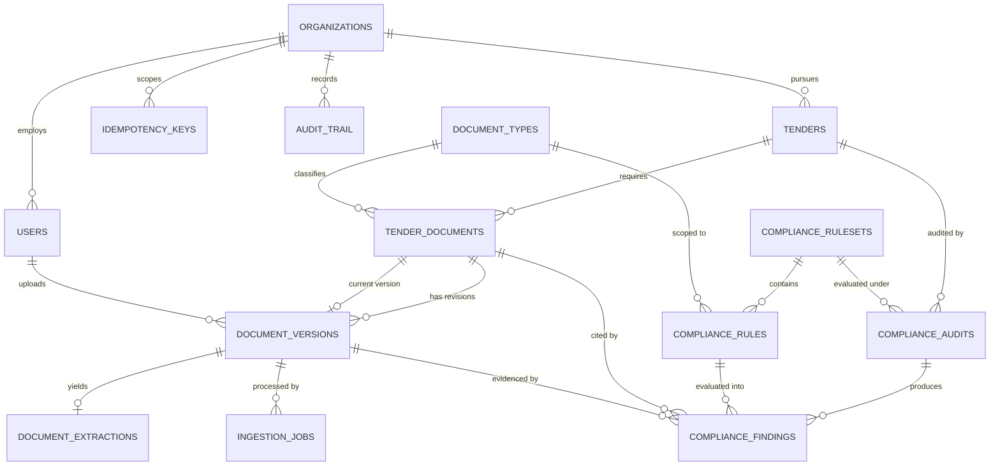
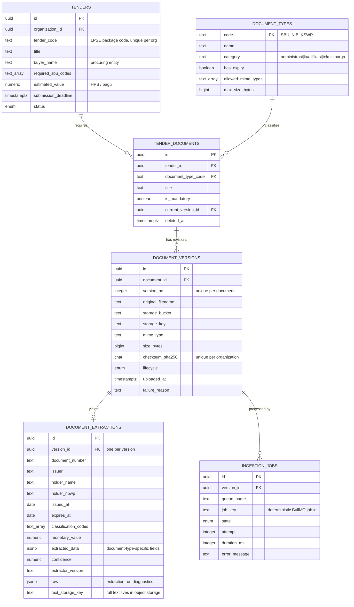
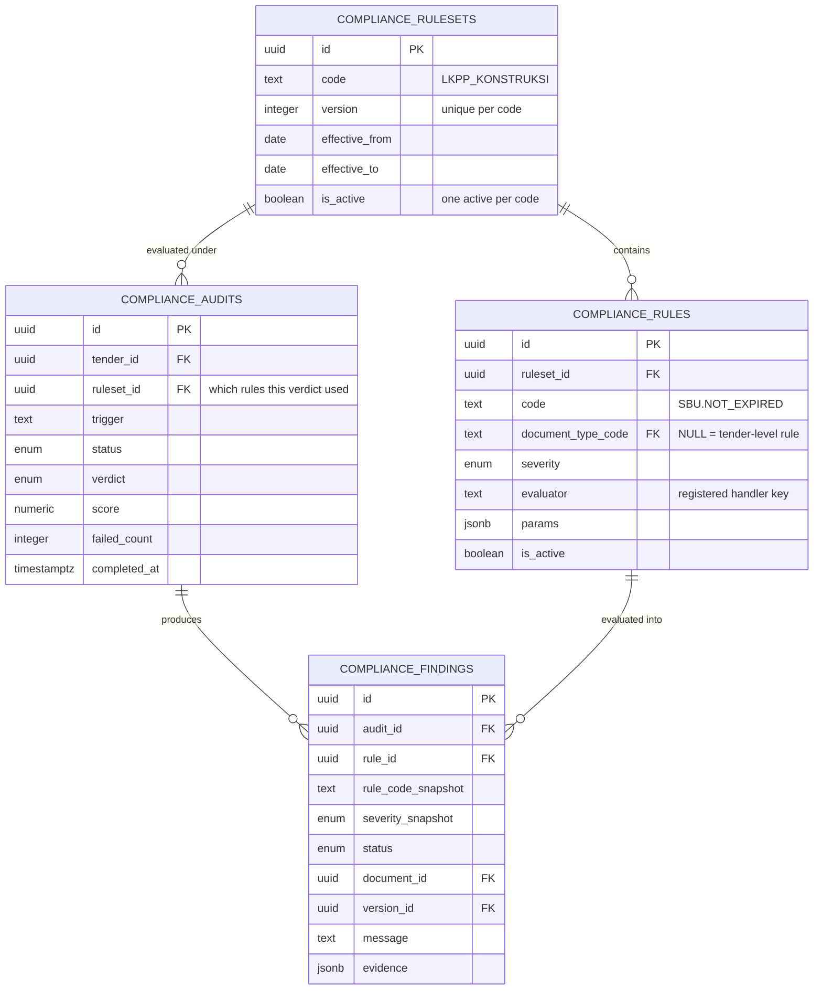

# Data Model — Tender Documents & Compliance Audit

The schema is defined in [`db/migrations/001_init_schema.sql`](../db/migrations/001_init_schema.sql).
Reference data — document types and compliance ruleset v1 — is in
[`002_seed_reference_data.sql`](../db/migrations/002_seed_reference_data.sql).

## 1. Domain in one paragraph

A contractor pursues a **tender** published on LPSE/SPSE. Each tender demands a
package of documents: qualification papers (SBU, NIB, SPT, KSWP, SKK for key
personnel), administrative papers (bid letter, integrity pact, bid bond) and
technical papers (method statement, schedule, safety plan, bill of quantities).
Bids are routinely disqualified for clerical reasons — a certificate that
expired two days before the deadline, an SBU whose subclassification does not
match the announcement, a bid bond below the required percentage. The
**compliance audit** module exists to catch exactly those before submission.

## 2. Relationship map



## 3. Module 1 — Tender Documents



### Why the split between `tender_documents` and `document_versions`

`tender_documents` is a **slot** — "this bid needs an SBU". `document_versions`
is the **file**. Separating them buys four things at once:

1. A corrected upload is a new version, never an overwrite. Nothing that a past
   audit cited can be silently changed underneath it.
2. `current_version_id` gives the API a single-row lookup for the active file
   without a correlated subquery or a window function.
3. A tender can legitimately need several documents of the same type — one SKK
   per key person — so no unique constraint on `(tender_id, document_type_code)`.
4. `checksum_sha256` is unique per **document slot** — `(document_id,
   checksum_sha256)` — so a repeat upload into the same slot is detected by the
   database rather than by convention, and the ingestion endpoint is safely
   retryable.

   The scope matters and was originally wrong. A tenant-wide unique index looks
   equivalent and is not: a contractor submits the same SBU, NIB and NPWP to
   every tender they bid for, so the second tender's upload was treated as a
   duplicate, answered `202`, and discarded — leaving that tender's slot empty
   while the audit reported the document as never uploaded. The same bytes in a
   *different* slot are a different document and get their own version row.

   Storage de-duplication is a separate concern and is preserved: object keys
   are content-addressed per tenant (`org/<id>/<shard>/<checksum>`), so one
   certificate across twelve tenders is one object and twelve version rows. The
   non-unique `(organization_id, checksum_sha256)` index is what answers "are
   these bytes already stored?" and lets the repeat upload skip the write.

`document_extractions` is a separate table rather than columns on
`document_versions` because extraction is re-runnable: a better parser version
replaces the extraction row and leaves the immutable file record alone. Full
document text is **not** stored in Postgres — only a `text_storage_key` pointing
at object storage, so rows stay small and the table stays cacheable.

### Three kinds of extraction data, kept apart

The fields an extractor produces differ by document type, so the table splits
them three ways rather than giving every possible field a column
([ADR 0004](adr/0004-hybrid-extraction-storage.md)):

| | Holds | Why there |
|---|---|---|
| Columns | `expires_at`, `holder_npwp`, `classification_codes`, `monetary_value`, … | A compliance rule, filter or index depends on them |
| `extracted_data` (jsonb) | `kbliCodes`, `qualificationGrade`, `guarantor` | Specific to one document type; nothing queries them yet |
| `raw` (jsonb) | `textLength`, `streamsDecoded` | Diagnostics about the parser run, not about the document |

A field is promoted from `extracted_data` to a column when something starts
querying it; the step in between is an expression or GIN index. Keeping `raw`
out of `extracted_data` means a query over document fields never has to step
around keys that describe the parser instead of the paper.

### Document lifecycle

```
pending ──► queued ──► processing ──► processed
                           │
                           ├──► failed        (retries exhausted)
                           └──► quarantined   (encrypted, corrupt, infected)
```

`pending` exists because the row is created before the bytes are committed to
storage. A row stuck in `pending` is an orphaned upload, and the partial index
`document_versions_lifecycle_idx` makes the sweeper that reaps them cheap.

## 4. Module 2 — Compliance Audit



### Rules are data, evaluators are code

A rule row names an `evaluator` — `not_expired_at_deadline`,
`classification_match`, `monetary_threshold` — and supplies its `params` as
JSONB. The code ships a small registry of evaluator implementations; the rules
themselves live in the database. Adding "KSWP must be younger than 14 days
instead of 30" is an `UPDATE`, not a deployment.

The evaluator key is deliberately **not** a free-form expression language. A
closed set of named, unit-tested evaluators is auditable; an embedded DSL is not,
and in a compliance product the ability to explain a verdict matters more than
the ability to express every conceivable rule.

### Why rulesets are versioned

Procurement regulation changes. If rules were mutable, a verdict rendered in
March would quietly mean something different in September, and the product could
not defend its own history. So:

- `compliance_audits.ruleset_id` pins the audit to an immutable ruleset version.
- `compliance_findings` snapshots `rule_code` and `severity` at evaluation time.
- A partial unique index allows exactly one active version per ruleset code.

Re-running an old audit reproduces the old verdict. That property is the whole
point of the module — **and it is currently enforced by convention, not by the
database.** Nothing stops an `UPDATE` to a ruleset an audit has already cited.
A trigger rejecting changes to a referenced ruleset is the missing piece; see
the README's known-gaps section.

Rulesets are also **global, not per-tenant**: every organisation is audited
against the same published regulation, which is why `compliance_rulesets` and
`compliance_rules` carry no `organization_id`. Per-tenant overrides would need
one on both tables. That is a product decision, not an oversight.

### `is_active` and the effective window are different questions

Both gate which ruleset an audit runs under, and both have to hold:

- **`is_active`** is the operator's switch — which version the product is
  currently running. A partial unique index allows one per ruleset code.
- **`effective_from` / `effective_to`** is the regulator's calendar — when that
  version actually applies.

Selecting on `is_active` alone would make the date columns decorative: a v2
prepared in October for a January rule change would take effect the moment
someone flipped the switch. Requiring both lets a future version be loaded,
reviewed and staged in advance and still start applying on the right date.
`ComplianceService.resolveRuleset` enforces both, and distinguishes "nothing
seeded" from "seeded but not yet in force" in its error, because those have
completely different fixes.

### Finding statuses

`pass` / `fail` / `warning` are self-explanatory. Two more exist for honest
reasons:

- `not_applicable` — the rule did not apply (no bid bond required below the
  value threshold). Recorded rather than omitted, so the report shows coverage.
- `inconclusive` — extraction confidence fell below `EXTRACTION.CONFIDENCE`.
  The system says "I could not read this reliably" instead of guessing. A
  compliance tool that silently passes an unreadable certificate is worse than
  no tool at all.

The audit verdict is derived, not entered: any `fail` at `blocker` or `critical`
severity makes the audit `non_compliant`; warnings alone yield
`compliant_with_warnings`.

## 5. Cross-cutting decisions

**Multi-tenancy.** Every tenant-owned table carries `organization_id`, even
where it is derivable through a join. The redundancy is deliberate: it lets one
Postgres RLS policy per table enforce isolation at the database boundary, which
is the mapping to Supabase described in the README. It also keeps composite
indexes tenant-leading, so one noisy tenant does not degrade another's queries.

**Enums vs lookup tables.** Closed state machines that change only with a code
change (`document_lifecycle`, `audit_status`) are native enums — self-documenting
and rejected at write time. Open vocabularies that regulation can extend
(`document_types`, rule codes) are tables, because they must be editable without
a migration.

**Money.** `numeric(18,2)` with an explicit `currency` column. Never floating
point; the bid bond threshold check compares values directly.

**Audit trail.** `audit_trail` is append-only, keyed by `(entity_type,
entity_id)`. Mutable rows answer "what is true now"; the trail answers "who
changed what, when" — a compliance product needs both.

**Soft delete.** Only `tender_documents` carries `deleted_at`, and the partial
indexes exclude deleted rows so the index stays the size of the live set.
Versions and findings are never soft-deleted; removing evidence from an audit
trail would defeat its purpose.
