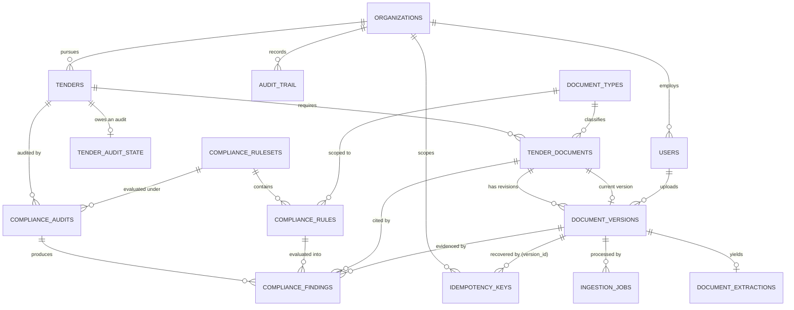
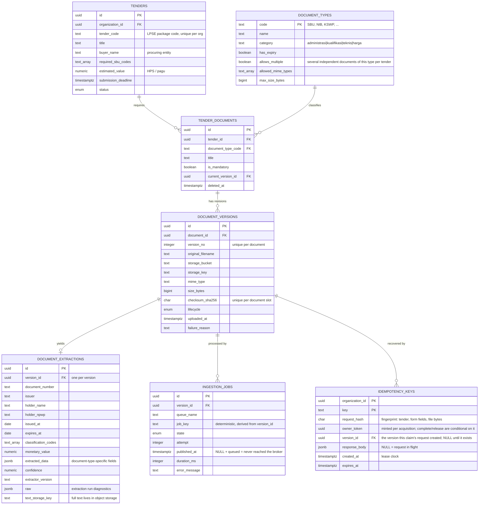

# Data Model — Tender Documents & Compliance Audit

The schema is defined in [`db/migrations/001_init_schema.sql`](../db/migrations/001_init_schema.sql).
Reference data — document types and compliance ruleset v1 — is in
[`002_seed_reference_data.sql`](../db/migrations/002_seed_reference_data.sql).
Four forward-only migrations follow:
[`003_ingestion_job_publication.sql`](../db/migrations/003_ingestion_job_publication.sql)
adds `ingestion_jobs.published_at` and the outbox index, and
[`004_reliability_corrections.sql`](../db/migrations/004_reliability_corrections.sql)
adds `idempotency_keys.owner_token`, `document_types.allows_multiple` and the
`tender_audit_state` table.
[`005_correct_schema_comments.sql`](../db/migrations/005_correct_schema_comments.sql)
carries no structural change — it corrects two column comments that outlived
their design.
[`006_idempotency_operation_link.sql`](../db/migrations/006_idempotency_operation_link.sql)
adds `idempotency_keys.version_id`, the link from a claim to the version its
request created. Applied migrations are never edited; corrections are appended,
and the migrator enforces that by checksum.

## 1. Domain in one paragraph

A contractor pursues a **tender** published on LPSE/SPSE. Each tender demands a
package of documents: qualification papers (SBU, NIB, SPT, KSWP, SKK for key
personnel), administrative papers (bid letter, integrity pact, bid bond) and
technical papers (method statement, schedule, safety plan, bill of quantities).
Bids are routinely disqualified for clerical reasons — a certificate that
expired two days before the deadline, an SBU whose subclassification does not
match the announcement, a bid bond below the required percentage. The
**compliance audit** module exists to catch exactly those before submission.

## 2. Relationship map



## 3. Module 1 — Tender Documents



The diagrams show the columns that carry design decisions, not every column;
the migrations are the complete definition. There are fifteen domain tables;
`schema_migrations` is the migrator's own bookkeeping and is not modelled.

### Why the split between `tender_documents` and `document_versions`

`tender_documents` is a **slot** — "this bid needs an SBU". `document_versions`
is the **file**. Separating them buys four things at once:

1. A corrected upload is a new version, never an overwrite. Nothing that a past
   audit cited can be silently changed underneath it.
2. `current_version_id` gives the API a single-row lookup for the active file
   without a correlated subquery or a window function.
3. A tender can legitimately need several documents of the same type — one SKK
   per key person — so no unique constraint on `(tender_id, document_type_code)`.
   Which types those are is data, not inference: `document_types.allows_multiple`
   marks them (`SKK_PERSONIL`, `SURAT_DUKUNGAN` in the seed), and it is what lets
   the ingestion path tell "the same document uploaded twice" from "two
   documents of the same kind". For a single-instance type, a second upload
   lands in the existing slot as a new version; for a multi-instance type it
   opens a new slot, because two key personnel are two documents even if a
   clerk attached the same scan to both.
4. `checksum_sha256` is unique per **document slot** — `(document_id,
   checksum_sha256)` — so a repeat upload into the same slot is detected by the
   database rather than by convention, and the ingestion endpoint is safely
   retryable.

   The scope matters and was originally wrong. A tenant-wide unique index looks
   equivalent and is not: a contractor submits the same SBU, NIB and NPWP to
   every tender they bid for, so the second tender's upload was treated as a
   duplicate, answered `202`, and discarded — leaving that tender's slot empty
   while the audit reported the document as never uploaded. The same bytes in a
   *different* slot are a different document and get their own version row.

   Storage de-duplication is a separate concern and is preserved: object keys
   are content-addressed per tenant (`org/<id>/<shard>/<checksum>`), so one
   certificate across twelve tenders is one object and twelve version rows. The
   non-unique `(organization_id, checksum_sha256)` index is what answers "are
   these bytes already stored?" and lets the repeat upload skip the write.

`document_extractions` is a separate table rather than columns on
`document_versions` because extraction is re-runnable: a better parser version
replaces the extraction row and leaves the immutable file record alone. Full
document text is **not** stored in Postgres — only a `text_storage_key` pointing
at object storage, so rows stay small and the table stays cacheable.

### Three kinds of extraction data, kept apart

The fields an extractor produces differ by document type, so the table splits
them three ways rather than giving every possible field a column
([ADR 0004](adr/0004-hybrid-extraction-storage.md)):

| | Holds | Why there |
|---|---|---|
| Columns | `expires_at`, `holder_npwp`, `classification_codes`, `monetary_value`, … | A compliance rule, filter or index depends on them |
| `extracted_data` (jsonb) | `kbliCodes`, `qualificationGrade`, `guarantor` | Specific to one document type; nothing queries them yet |
| `raw` (jsonb) | `textLength`, `streamsDecoded` | Diagnostics about the parser run, not about the document |

A field is promoted from `extracted_data` to a column when something starts
querying it; the step in between is an expression or GIN index. Keeping `raw`
out of `extracted_data` means a query over document fields never has to step
around keys that describe the parser instead of the paper.

### Document lifecycle

```
pending ──► queued ──► processing ──► processed
                           │
                           ├──► failed        (retries exhausted)
                           └──► quarantined   (no extractable text; no malware scanning exists)
```

`pending` exists because the row is created before the bytes are committed to
storage. A row stuck in `pending` is an orphaned upload, and the partial index
`document_versions_lifecycle_idx` makes the sweeper that reaps them cheap.

**`pending` and `queued` are not recovered the same way.** A `queued` version
has a ledger row in `ingestion_jobs` and a slot pointer; if `published_at` is
null the only thing missing is the publish, so republishing it is correct. A
`pending` version has neither. Publishing it bare hands a worker a version with
no ledger row to update and a slot that still points elsewhere, so recovery has
to finish the promotion first — write the ledger row, advance the pointer, then
publish — which is exactly what `completePendingPromotion` does. The promotion
is a conditional transition (`UPDATE … WHERE lifecycle = 'pending'`), so two
concurrent recoveries cannot both perform it and a stale one cannot write
`queued` over `processed`; the loser reports the persisted lifecycle. A resume path
that treated both states as "just republish" would quietly process documents
that never became the slot's current version.

### `ingestion_jobs` is also the outbox

The broker owns live job state; this table is the durable, queryable history
behind retry analysis and dead-letter review — questions Redis cannot answer a
week later once completed jobs are trimmed.

It carries one more job. The API commits this row and *then* publishes to the
broker, so a process that dies in between leaves committed intent nobody will
act on. `published_at` makes publication itself a durable fact: a `queued` row
with `published_at IS NULL` is precisely that case, and `IngestionReconciler`
republishes it. A partial index on those two columns keeps the sweep cheap — in
a healthy system it matches no rows at all.

That is the whole outbox: an existing ledger plus one column. No relay service,
no change-data-capture.

## 4. Module 2 — Compliance Audit

```mermaid
erDiagram
    COMPLIANCE_RULESETS {
        uuid        id PK
        text        code            "LKPP_KONSTRUKSI"
        integer     version         "unique per code"
        date        effective_from
        date        effective_to
        boolean     is_active       "one active per code"
    }
    COMPLIANCE_RULES {
        uuid        id PK
        uuid        ruleset_id FK
        text        code            "SBU.NOT_EXPIRED"
        text        document_type_code FK "NULL = tender-level rule"
        enum        severity
        text        evaluator       "registered handler key"
        jsonb       params
        boolean     is_active
    }
    COMPLIANCE_AUDITS {
        uuid        id PK
        uuid        tender_id FK
        uuid        ruleset_id FK   "which rules this verdict used"
        text        trigger
        enum        status
        enum        verdict
        numeric     score
        integer     failed_count
        timestamptz completed_at
    }
    COMPLIANCE_FINDINGS {
        uuid        id PK
        uuid        audit_id FK
        uuid        rule_id FK
        text        rule_code_snapshot
        enum        severity_snapshot
        enum        status
        uuid        document_id FK
        uuid        version_id FK
        text        message
        jsonb       evidence
    }

    TENDER_AUDIT_STATE {
        uuid        tender_id PK_FK
        uuid        organization_id FK
        boolean     pending          "an audit is owed"
        text        scheduled_job_id "the run currently carrying that intent"
        timestamptz requested_at
        timestamptz last_audited_at
    }

    COMPLIANCE_RULESETS ||--o{ COMPLIANCE_RULES : contains
    COMPLIANCE_RULESETS ||--o{ COMPLIANCE_AUDITS : "evaluated under"
    COMPLIANCE_AUDITS ||--o{ COMPLIANCE_FINDINGS : produces
    COMPLIANCE_RULES ||--o{ COMPLIANCE_FINDINGS : "evaluated into"
    TENDERS ||--o| TENDER_AUDIT_STATE : "owes an audit"
```

### `tender_audit_state` — intent in Postgres, schedule in Redis

One audit per burst of uploads is the goal: a contractor attaching twelve files
wants one verdict, not twelve. The first attempt at that reused a single
deterministic BullMQ job id per tender and let id collisions do the
de-duplication. It coalesced correctly only in the easy case, and failed in two
that matter:

- A request arriving while the audit was **active** resolved to the running job.
  BullMQ returns the existing job rather than queueing another, so the request
  was dropped and the document that triggered it was never audited.
- A **failed** job was retained for a week under that id, and for that week the
  tender could not be audited at all.

Splitting the two facts fixes both. The table says an audit is *owed*
(`pending`); the queue says one is *scheduled* (`scheduled_job_id`, now unique
per run, so a retained failure can never occupy the name the next run needs).

| Situation | What happens |
|---|---|
| Request arrives, nothing scheduled | `pending = true`, one job published, its id recorded |
| Request arrives, job waiting or delayed | `pending` already true — collapses onto it; the run reads the tender's state when it finally executes, so it covers the later request too |
| Request arrives, job **active** | `pending` set again, nothing scheduled — the running job still holds `scheduled_job_id`. On completion `finishRun` frees the slot and reports `pending` atomically, and the processor schedules one follow-up that starts after this run ended |
| Job **fails for good** (final attempt) | the worker's `failed` handler restores `pending` and frees the slot; the reconciler or the next request schedules a run under a fresh id, so the retained failed job never blocks. Retried attempts leave the slot with the retrying job |
| Intent recorded, publish never happened | `IngestionReconciler.reconcileAudits` finds `pending` rows with no live job and schedules one |

A run calls `claimPending` *before* reading any documents, which is what makes
"a document landed mid-audit" detectable: anything that sets the flag after that
point is work this run demonstrably did not see. `claimPending` clears `pending`
but keeps `scheduled_job_id`; only `finishRun` (or a terminal failure) frees it. The partial index on
`requested_at WHERE pending` is the reconciler's query and matches nothing in a
healthy system.

### Rules are data, evaluators are code

A rule row names an `evaluator` — `not_expired_at_deadline`,
`classification_match`, `monetary_threshold` — and supplies its `params` as
JSONB. The code ships a small registry of evaluator implementations; the rules
themselves live in the database. Adding "KSWP must be younger than 14 days
instead of 30" is an `UPDATE`, not a deployment.

The evaluator key is deliberately **not** a free-form expression language. A
closed set of named, unit-tested evaluators is auditable; an embedded DSL is not,
and in a compliance product the ability to explain a verdict matters more than
the ability to express every conceivable rule.

### Why rulesets are versioned

Procurement regulation changes. If rules were mutable, a verdict rendered in
March would quietly mean something different in September, and the product could
not defend its own history. So:

- `compliance_audits.ruleset_id` pins the audit to an immutable ruleset version.
- `compliance_findings` snapshots `rule_code` and `severity` at evaluation time.
- A partial unique index allows exactly one active version per ruleset code.

Re-running an old audit reproduces the old verdict. That property is the whole
point of the module — **and it is currently enforced by convention, not by the
database.** Nothing stops an `UPDATE` to a ruleset an audit has already cited.
A trigger rejecting changes to a referenced ruleset is the missing piece; see
the README's known-gaps section.

Rulesets are also **global, not per-tenant**: every organisation is audited
against the same published regulation, which is why `compliance_rulesets` and
`compliance_rules` carry no `organization_id`. Per-tenant overrides would need
one on both tables. That is a product decision, not an oversight.

### `is_active` and the effective window are different questions

Both gate which ruleset an audit runs under, and both have to hold:

- **`is_active`** is the operator's switch — which version the product is
  currently running. A partial unique index allows one per ruleset code.
- **`effective_from` / `effective_to`** is the regulator's calendar — when that
  version actually applies.

Selecting on `is_active` alone would make the date columns decorative: a v2
prepared in October for a January rule change would take effect the moment
someone flipped the switch. Requiring both lets a future version be loaded,
reviewed and staged in advance and still start applying on the right date.
`ComplianceService.resolveRuleset` enforces both, and distinguishes "nothing
seeded" from "seeded but not yet in force" in its error, because those have
completely different fixes.

### Finding statuses

`pass` / `fail` / `warning` are self-explanatory. Two more exist for honest
reasons:

- `not_applicable` — the rule did not apply (no bid bond required below the
  value threshold). Recorded rather than omitted, so the report shows coverage.
- `inconclusive` — extraction confidence fell below `EXTRACTION.CONFIDENCE`.
  The system says "I could not read this reliably" instead of guessing. A
  compliance tool that silently passes an unreadable certificate is worse than
  no tool at all.

The audit verdict is derived, not entered: any `fail` at `blocker` or `critical`
severity makes the audit `non_compliant`; warnings alone yield
`compliant_with_warnings`.

## 5. Cross-cutting decisions

**Multi-tenancy.** Most tenant-owned tables carry `organization_id`, even where
it is derivable through a join. The redundancy is deliberate: it lets one
Postgres RLS policy per table enforce isolation at the database boundary, which
is the mapping to Supabase described in the README. It also keeps composite
indexes tenant-leading, so one noisy tenant does not degrade another's queries.

Two exceptions are worth naming rather than glossing: `document_extractions`
and `compliance_findings` have no `organization_id` and are reached only
through their parent (`version_id`, `audit_id`). They are covered by the
service layer today, and a direct RLS policy on them would need the column
added first. **No RLS policy is currently defined on any table** — there is no
`CREATE POLICY` in the migrations. The column layout is what makes those
policies possible; it is not the same as having written them. See the README's
known-gaps section.

**Idempotency claims have an owner, not just an age.** `idempotency_keys` is
keyed `(organization_id, key)` and stores `request_hash` so the same key with a
different file is rejected rather than answered with the first upload's
response. The claim is taken with a conditional `INSERT`, so exactly one
concurrent request proceeds and the rest read the stored response; `expires_at`
lets a claim abandoned by a crashed request be taken over.

`version_id` (migration 006, nullable FK to `document_versions`, `ON DELETE SET
NULL`) records the version the claim's request created. It is written in the
same transaction as the version, conditional on `owner_token`, and carried to a
takeover only when the request fingerprint matches and no response was recorded;
the successor then recovers that version instead of filing another. A claim
whose request already created a version is not deleted on failure but made
immediately takeable. Application convention backed by an FK, not a constraint
that forbids a second version.

A lease alone is not enough. The original request may still be alive — merely
slow — and would then complete or release a claim its successor now holds,
writing one request's response under another's key. `owner_token` (migration
004) is minted on **every** acquisition, including a takeover, and both
completion and release are conditional on it. The lease decides when a claim
may be taken; the token is what makes a wrong lease decision safe rather than
corrupting.

**Concurrent slot allocation.** Two uploads of the same document type arriving
together must not create two slots for a single-instance type. The emptiness
test cannot be `current_version_id IS NULL`, because the pointer is set after
the version transaction commits; it is `NOT EXISTS (SELECT 1 FROM
document_versions …)`. That predicate is also unindexable against a row that
does not exist yet, so `SELECT … FOR UPDATE` has nothing to lock — the classic
phantom. A transaction-scoped advisory lock keyed on
`slot:<tender>:<type-code>` serialises the decision instead, and
`current_version_id` only ever moves forward (the `UPDATE` compares
`version_no`), so a slow earlier version cannot demote a newer one.

**Enums vs lookup tables.** Closed state machines that change only with a code
change (`document_lifecycle`, `audit_status`) are native enums — self-documenting
and rejected at write time. Open vocabularies that regulation can extend
(`document_types`, rule codes) are tables, because they must be editable without
a migration.

**Money.** `numeric(18,2)` with an explicit `currency` column. Never floating
point; the bid bond threshold check compares values directly.

**Audit trail.** `audit_trail` is append-only, keyed by `(entity_type,
entity_id)`. Mutable rows answer "what is true now"; the trail answers "who
changed what, when" — a compliance product needs both.

**Soft delete.** Only `tender_documents` carries `deleted_at`, and the partial
indexes exclude deleted rows so the index stays the size of the live set.
Versions and findings are never soft-deleted; removing evidence from an audit
trail would defeat its purpose.
